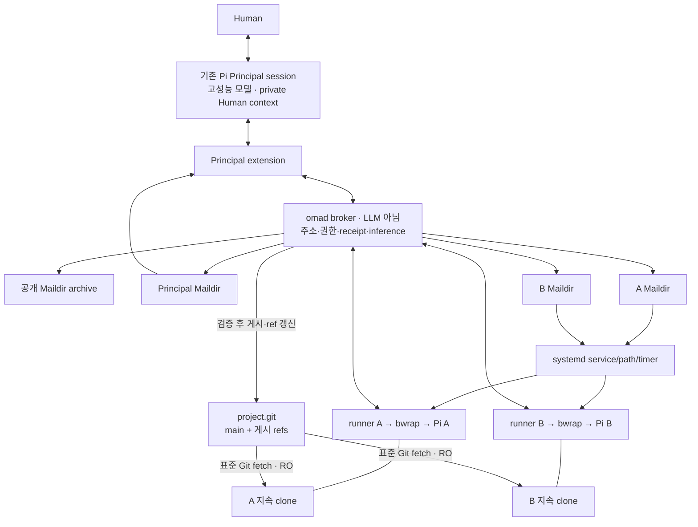

# OMA 구현 아키텍처: Principal + Unix 메일링 리스트 사회 + Git

이 문서는 이전 설계를 대체한다. 사용자 제공 새 구조와 추가 프로토타입을 기준으로 **어떤 프로그램이 어떤 프로세스로 실행되고, 어떤 파일과 호출을 통해 연결되는지**를 결정했다. 기존 OMA 저장소 코드는 확인하지 않았다. 아래 OMA 명령·모듈·설정은 구현할 계약이며, 이미 동작하는 제품이라는 뜻은 아니다.

2026-09-22 WP01의 [D01–D06 결정 기록](implementation/consistency-decisions.md)은 delivery 복구 순서, 관리형 config generation, 배포 gate, admission/settlement, 프로젝트 binding과 적용 시점, no-op/unknown의 아래 상세화를 채택한다. 이는 C0–C2 설계 범위이며 runtime 구현·운영 검증 완료가 아니다. DB/wire/receipt version과 live caller 권한은 유지한다. 미구현 차이는 해당 WP의 명시적 gate로 남긴다.

## 모듈 책임과 공개 경계 (DR41, 2026-10-10)

[DR41](design-revisions.md#dr41--tuiapplicationruntimeextension-모듈-경계)는 기존 프로세스·durable 계약을
유지하면서 제품의 변경 책임을 분리한다. Application/Entry가 설정 저장·메일·관측과 세션을
조립한다. TUI는 화면·입력·ViewModel과 Pi 화면 adapter를 소유하며 Runtime·Application·파일 저장
구현을 가져오지 않는다. `SocietyPanelEffects`는 완전한 설정 view와 행동만 전달하며 managed
snapshot·경로·저장소 handle을 전달하지 않는다. `saved-unread`, 예외로 남는 publication 불확실,
bootstrap unknown과 실제 OS 종료를 기존 의미대로 유지한다.

Principal 실행·입력·수명은 `runtime/engine/`, package store와 tar 해석은 `runtime/packages/`,
플랫폼별 staging·directory 효과는 Platform이 소유한다. 설치 조정은 `application/local-packages.ts`다.
Runtime은 TUI/Application 구현을 모르며 화면 오류 표현을 port로 받는다. Application이 host의
package directory port를 선택한다. Broker·Store·acceptance·recovery의 소유권은 바꾸지 않는다.

공개 TUI subpath와 package `index` 경계는 기존 architecture checker에서 type-only·지연 import와
재수출까지 검사한다. 공개 subpath 목록 하나에서 TUI 산출물의 exports도 만든다. Extension은 기존
`pi-extension` 진입점·contracts/client·Pi API·검증된 vendor closure를 유지한다. 독립 빌드는
`node scripts/build-module.mjs tui --out <새-경로>`와 `extension --out <새-경로>`다.
각 산출물은 ESM·declaration·의존성 manifest를 포함하고 Extension은 복사 전후 검증된 vendor와
Pi extension manifest를 포함한다. npm 의존성 설치는 산출물의 manifest를 따른다. 이 빌드는 별도
프로세스나 npm workspace를 추가하지 않는다. Resident에서 가렸던 host 제품 코드도 이동한
Application·Principal owner·화면 정책 경로로 계속 가린다.

## 1. 선택한 구조와 철학의 구현 위치

**고성능 Principal 한 세션 + 저비용 Resident 여러 세션 + 공개 메일링 리스트 + 개별 Maildir + 공유 Git remote + systemd 실행 관리**를 사용한다.

| 영역 | 재사용하는 프로그램/형식 | OMA가 작성하는 연결 |
|---|---|---|
| cognition/session | Pi | 메일 알림 extension, 한 session용 runner |
| process 관리 | systemd service/path/timer, cgroup | 고정 unit 생성, 제한된 start/stop |
| 격리 | bubblewrap | mount·환경·IPC profile |
| 메일 원문 | Maildir, 표준 email | 발신자 인증, 주소 확장, 로컬 배달 |
| 커뮤니티 | 공개 메일링 리스트 방식 | commons/topic 수신자 계산 |
| 검색 | rg/find, 선택적으로 notmuch | index 생성 작업 연결 |
| 코드·문서·버전 | Git | 게시된 commit 보존, shared ref 권한 검사 |
| 복제 비용 | 지속 clone, 선택적 reflink | 최초 workspace 생성 시 최적화 |
| 진단 | journald | society에 한정한 읽기 |
| effect/전달/비용 | SQLite | 작은 transaction·reconciliation |
| inference | Pi provider adapter, Unix socket | credential 보호·stream 중계 |

systemd가 process를 관리하므로 PID registry와 restart supervisor를 새로 만들지 않는다. Maildir가 본문을 보존하므로 Board body DB를 만들지 않는다. Git이 버전을 관리하므로 Change/Artifact lifecycle을 만들지 않는다. 단, 이 도구들이 서로 알아서 연결되는 것은 아니므로 아래 연결 코드는 필요하다.

| 사용자 철학 | 구조적 구현 |
|---|---|
| Astra attention·비용 절약 | Principal은 commons/topic의 기본 수신자가 아니다. 질문·결과를 명시적으로 보낼 때만 전달한다. |
| 어려운 판단은 Principal | 모든 Resident가 principal에 직접 질문한다. Principal은 전체 의도와 원자료 접근권을 유지한다. |
| 자율적 커뮤니티 | commons, topic, peer 주소로 직접 대화한다. Principal의 배정 없이 작업·검증·게시 가능. |
| Linux/Git 재사용 | 완전한 원문 파일과 Git refs를 노출한다. 전용 preview/range/search 언어 없음. |
| 모델 인지 부담 최소화 | 시작 안내 한 장, inbox 목록 한 장, 기본 명령 네 가지. 내부 DB/unit 관리는 모델의 업무가 아님. |
| workflow를 강제하지 않음 | topic은 주소, reply는 thread, 의도는 메일 본문이다. task 단계·reviewer 배정은 없음. |

목표는 Principal 사용량과 총비용을 줄이면서 고성능 단독과 비슷하거나 더 높은 품질을 얻는 것이다. 이는 검증할 가설이다. 저비용 모델의 token 총량까지 반드시 줄어든다고 가정하지 않는다.

## 2. 실제 프로세스와 연결



`omad`는 메일 본문을 평가하거나 업무를 배분하지 않는다. 주소·권한·크기·현재 ref·request key 같은 기계적 정보를 처리한다. mail router, Git boundary, inference relay는 같은 broker의 모듈이며 별도 서버로 분리하지 않는다.

배포는 Linux 한 호스트, society당 broker 하나, 활성 Resident당 runner 하나와 sandboxed Pi 하나다. Principal에는 기존 Human 대화 session의 extension을 붙인다. 메일마다 별도의 Astra를 spawn하지 않는다.

## 3. Maildir와 커뮤니티의 결합

Maildir는 **1:1 통신 규칙이 아니라 메일 한 통을 파일 하나로 저장하는 형식**이다. tmp/new/cur를 제공하며, 수신자 선택·방송·wake는 OMA가 연결한다. 따라서 방송을 위해 별도의 감독 모델이 필요한 것은 아니다. [Maildir 형식](https://manpages.debian.org/unstable/qmail/maildir.5.en.html)

외부 SMTP/IMAP 서버는 운영하지 않는다. 같은 호스트의 Unix socket으로 메일을 접수하고, 메일링 리스트 방식으로 수신자를 확장한다. Mailman 전체를 설치하거나 SMTP protocol을 새로 구현하지 않는다.

### 3.1 주소와 수신자

| 주소 | 접수 시 수신자 집합 | Principal 포함? |
|---|---|---|
| `a`, `b` | 해당 stable Resident | 아니오 |
| `principal` | 해당 society의 Principal mailbox | 예 |
| `commons` | 모든 비은퇴 Residents | 아니오 |
| `topic/auth` | auth를 follow한 Residents | 아니오 |
| `residents` | 모든 비은퇴 Residents; context 알림용 | 아니오 |

복수 주소는 집합 합집합으로 중복 제거한다. stopped Resident도 수신자이며 mail은 저장하지만 깨우지 않는다. recipient snapshot 이후 생성된 Resident는 과거 broadcast 수신자가 되지 않는다. 대신 최신 GOAL을 받는다.

`commons`는 모든 Resident가 기본 연결되는 광장이다. Principal을 포함하는 암묵적 all 주소를 기본으로 두지 않는다. Principal에게도 알리려면 principal을 명시한다.

### 3.2 직접 대화

```bash
oma send b --subject '토큰 갱신 재현 확인' --file question.md
```

```text
A CLI → A 전용 socket → broker 발신자 확인
  → 공개 archive에 원문 한 번 저장
  → B mailbox에 동일 원문 link
  → B wake/실행 중 알림
```

Principal은 이 경로에 참여하지 않는다.

### 3.3 공개 게시와 topic

```bash
oma send commons --subject '인증 경로를 조사하겠습니다' --file intent.md
oma follow auth
oma send topic/auth --subject '갱신 경쟁 조건 재현' --file finding.md
```

```text
commons    → [A, B, C] mailbox
topic/auth → [A, C] mailbox
              └→ 공개 archive에서는 B도 검색 가능
```

topic은 첫 게시 또는 follow에서 생성한다. 구독자가 없으면 archive에만 남기고 수신자 0명을 응답한다. unfollow는 미래 배달만 바꾼다. thread 구독, task claim, reviewer 배정 시스템을 덧붙이지 않는다.

### 3.4 답장과 thread

```bash
oma send --reply /mail/archive/cur/m42:2, --file answer.md
```

CLI가 Message-ID, Reply-To, In-Reply-To, References를 처리한다. direct mail에는 발신자로, commons/topic mail에는 리스트로 답장한다. 명시적 수신자를 주면 그 주소를 우선하고 실제 대상 목록을 출력한다. 모델은 받은 파일 경로를 그대로 쓴다.

### 3.5 공개 범위

v1 peer mail과 Principal에게 보내는 협업 질문은 society 공개 자료다. To는 알림 대상이며 비밀 대화 ACL이 아니다. Human 원문 대화와 Principal private memory는 archive 밖에 둔다. 비공개 peer 대화는 실제 요구가 있을 때 별도 ACL로 확장한다.

## 4. 파일과 권한

예시 society는 demo, agent는 a와 b다.

```text
~/.local/share/oma/demo/
  config.json                      Human 소유 권한/자원 설정
  runtime.sqlite                   effects, routing, delivery, attestation
  repos/
    project.git/                   main + immutable 게시 refs
    context.git/                   Principal의 공유 목적과 판단
  seed/                            선택적 고정 clone template
  mail/
    objects/<id>.eml                broker 전용 immutable 원문
    archive/{tmp,new,cur}/          접수된 공개 원문 links
    inboxes/a/{tmp,new,cur}/
    inboxes/b/{tmp,new,cur}/
    inboxes/principal/{tmp,new,cur}/
  agents/a/
    workspace/                     지속 clone, 자기 .git
    home/                          Pi session과 notes
    runner/                        trusted batch/receipt
  agents/b/...
  principal/private/               Human context와 private memory
  world/
    START.md
    agents.tsv
    topics.tsv
    context/current -> revisions/<oid>/
    context/revisions/<oid>/
  index/notmuch/                   선택적 재생성 index
  staging/                         미완료 메일/Git 수입
```

socket은 긴 state 경로 대신 systemd user runtime directory `%t/oma/demo/`에 둔다.

| Resident sandbox 경로 | 내용 | 권한 |
|---|---|---|
| `/workspace` | 자기 clone | RW |
| `/home/agent` | 자기 session/notes | RW |
| `/tmp` | 제한된 임시 공간 | RW |
| `/mail/archive` | 공개 Maildir | RO |
| `/mail/self` | 자기 mailbox | RO |
| `/mail/index` | 선택적 notmuch index | RO |
| `/run/oma-view` | 자기 runner의 공개 안내 디렉터리 | RO |
| `/inbox.md` | `/run/oma-view/inbox.md`로 가는 symlink | RO |
| `/world` | 주민·topic·공유 context | RO |
| `/git/project.git` | 공유 Git remote | RO |
| `/run/oma/control.sock` | 자기 실행 endpoint | 연결만 |

DB, 다른 agent의 RW tree, host home, provider secret, systemd user bus를 mount하지 않는다. Principal도 공개 세계와 자기 scratch 환경만 모델 도구에 노출한다.

동적으로 교체되는 inbox.md를 파일 단위로 bind mount하지 않는다. 그러면 atomic rename 뒤에도 sandbox가 옛 inode를 볼 수 있다. **부모 디렉터리를 mount하고 그 안의 파일을 교체**한다. world와 mailbox도 같은 이유로 안정된 부모 디렉터리를 mount한다. model에는 내부 경로 대신 `/inbox.md`만 알려준다.

state tree 안의 모든 변경은 **부모 디렉터리를 한 번만 해석하고, 그 뒤로 경로를 다시 말하지 않는다**. 경로를 해석해 무엇인지 확인한 다음 같은 경로에 효과를 가하는 두 줄은 서로 다른 두 번의 namespace 탐색이고, 같은 UID의 어떤 프로세스든 그 사이에 component 하나를 갈아치울 수 있으므로 확인한 대상과 쓴 대상이 같다는 보장은 "아무도 시도하지 않았을 때"뿐이다. 나중에 다시 확인해도 창이 좁아질 뿐 닫히지 않는다 — 확인과 사용은 여전히 두 번의 탐색이다. 그래서 부모는 `openat2(RESOLVE_BENEATH|RESOLVE_NO_SYMLINKS)`로 한 번 열고, 그 descriptor가 가리키는 inode를 상대로만 이름을 짓는다. 열린 descriptor는 그 디렉터리를 이름이 아니라 inode로 붙잡으므로 이후 그 경로를 rename·unlink·교체해도 움직이지 않는다. 이 규칙은 주석이 아니라 primitive다: `withinDirectory(path, (parent, name) => ...)`는 본문에 부모 descriptor와 leaf 이름만 넘기므로 경로를 다시 해석하려면 따로 가져와야 하고, 그것이 이 모양의 목적이다. FS-005가 "같은 UID에서 파일 mode로 경계를 주장할 수 없다"고 말한 것과 같은 교훈을 mode가 아니라 namespace에 적용한 것이며, society lease가 pathname을 버리고 abstract namespace로 간 이유와도 같다.

원본은 명확히 구분한다. 본문/header는 eml, 수신·접수·배달은 SQLite, 코드/문서는 Git, process 생존은 systemd, model session은 Pi 파일이다. index·목록·inbox.md는 파생 데이터다. 불일치는 broker가 대조하고 모델에게 join을 맡기지 않는다.

## 5. 메일의 저장·배달·복구

### 5.1 원문

표준 email header와 UTF-8 plain text body를 쓴다. email 라이브러리로 encoding과 header injection을 처리한다. 큰 결과는 MIME 첨부 대신 Git reference로 보낸다.

```text
From: a@demo.oma.invalid
To: topic-auth@demo.oma.invalid
Reply-To: topic-auth@demo.oma.invalid
Message-ID: <m42@demo.oma.invalid>
In-Reply-To: <m31@demo.oma.invalid>
References: <m31@demo.oma.invalid>
Subject: Refresh race reproduced
Date: <generated date>
MIME-Version: 1.0
Content-Type: text/plain; charset=utf-8
Content-Transfer-Encoding: 8bit
X-OMA-Kind: message
X-OMA-Context: <context-oid>

동시 갱신 시 토큰이 무효화되는 현상을 재현했다.
재현 코드: project <commit> tests/refresh-race.test.ts
```

From/ID/시각은 broker가 확정한다. kind는 message/question/result/alert/context/approval_required/critical로 구분하며 권한을 뜻하지 않는다. approval_required는 exact identity를 가진 승인 요청이고 critical은 긴급 인지 요청이다. 의미와 권한의 구분은 §8.5를 따른다. 본문의 'Human approved' 문자열은 인증 metadata가 아니다.

### 5.2 접수 순서

```text
CLI request key 로컬 기록
 → actor socket으로 요청
 → identity/주소/크기/quota 검사
 → staging에 eml 전체 기록 + fsync
 → objects/<id>.eml 게시 + directory fsync
 → DB transaction: operation + recipient snapshot + deliveries
 → accepted 응답 가능
 → archive/cur와 recipient/new에 원문 link 게시 + fsync
 → delivery=delivered 기록
 → wake hint
```

objects는 비공개여서 DB 접수 전 내용이 archive에 먼저 보이지 않는다. hardlink는 같은 filesystem에서 쓰고 원문과 모든 link를 agent에게 RO로 제공한다. 하나라도 RW 경로가 있으면 공유 inode 변경이 가능하므로 허용하지 않는다. 다른 filesystem이면 임시 복사 후 atomic publish한다.

게시가 접수보다 앞서므로 **접수되지 않은 게시물의 주인은 아무도 아니다**. 같은 key를 동시에 요청한 두 호출은 둘 다 `claimKey`에서 `absent`를 보고 각자 다른 messageId를 고정할 수 있고, transaction에서 진 쪽, 거부된 쪽, linked로 흡수되어 그 message를 이름으로 갖지 않게 된 쪽은 자기가 만든 inode를 남긴다. 그래서 `freezeObject`는 void가 아니라 **pre-accept artifact**를 돌려주고, 소유 조건은 단 하나 — 그 artifact를 이름으로 가진 operation이 ledger에 접수되었는가 — 다. `mail.send`, `git.submit`, `agent.create`, `context.publish`는 모두 이 한 질문(`PreacceptScope`의 정산)으로 정산한다. 정산은 자기가 게시한 dev/ino와 지금 그 이름이 가리키는 inode가 같을 때만 unlink하므로 교체된 이름이나 남의 artifact는 건드리지 않고, 두 번 불러도 같다. DB를 읽을 수 없어 접수 여부를 알 수 없으면 삭제하지 않고 보존한다 — 불확실성은 삭제 권한이 아니다. bundle spool(`PreparedSubmitSpool`)도 접수 전에 게시된 같은 종류의 물건이라 같은 interface(`PreacceptOwner`)를 구현하고 같은 질문으로 정산된다. 반대로 preparation artifact는 의도의 기록이므로 연결이 끊겨도 남긴다.

### 5.3 방송 도중 죽으면

DB에 snapshot `[a,b,c]`, a/b delivered, c pending이 남는다. 재시작하면 c만 배달한다. 파일 게시 뒤 DB 완료 전에 죽었으면 new 또는 cur의 고정 ID를 확인해 완료 기록만 보충한다. mailbox rename은 broker/runner만 하므로 확인 경로는 고정된다.

파일 게시와 SQLite를 하나의 가상 transaction으로 취급하지 않는다. object 먼저, 접수 DB 다음, 읽기 표면과 배달 다음이라는 순서로 복구 가능하게 한다.

### 5.4 전달과 인지

| 상태 | 정확한 의미 |
|---|---|
| accepted | 원문·recipient snapshot 영속 접수 |
| delivered | mailbox의 완전한 파일 존재 |
| staged | 영속 runner batch에 포함 |
| presented | Pi 안내 batch의 정상 완료 경계를 기록 |
| ack | 수신자가 명시적으로 확인 의사를 보냄 |

presented는 본문을 읽거나 이해했다는 증거가 아니다. new→cur도 시스템의 처리 인수일 뿐 동의·작업 완료가 아니다. 일반 mail에 ACK를 강요하지 않는다. 필요할 때만 `oma ack <mail>`을 쓴다. 승인에는 별도 권한 조건을 적용한다.

## 6. systemd lifecycle의 구체적 연결

### 6.1 unit

```text
oma-demo-a.path + oma-demo-a.service
oma-demo-b.path + oma-demo-b.service
oma-demo-principal.path + oma-demo-principal-relay.service
```

agent 생성 시 고정 unit 파일을 쓴다. transient unit 이름에 durable agent identity를 의존하지 않는다. 검증된 slug와 상수 인자로만 unit을 생성한다.

제품의 broker는 소유자가 foreground로 직접 실행하는 하나뿐이다. 그래서 broker.service 같은 고정 broker unit은 존재하지 않으며, Resident unit도 어떤 broker unit에 bind하지 않는다 — unit에는 자기 state tree를 가리키는 `X-OMA-Owner`와 render된 launch location만 새긴다. 주기 reconcile도 외부 service/timer가 아니라 broker process 안의 5초 sweep이다(§6.5). DB 복구·이전 실행 정리·endpoint 준비는 broker가 자기 수명 안에서 끝내고, 기존 실행 정리가 끝나기 전에 새 Resident에 권한을 발급하지 않는다. 제품이 직접 소유한 foreground broker는 §23의 private channel과 tenure를 유지한다. 존재하지 않는 broker.service 의존이나 별도 broker의 은밀한 시작으로 우회하지 않으며, 검증되지 않은 조합은 활성화를 거절한다. 아래 unit 초안은 [implementation/systemd](implementation/systemd/)의 renderer가 실제 생성하는 형식이다.

### 6.2 Resident service 초안

```ini
[Unit]
Description=OMA demo resident a
X-OMA-Owner=/home/user/.local/share/oma/demo
StartLimitIntervalSec=60
StartLimitBurst=5

[Service]
Type=exec
ExecStart=/usr/lib/oma/oma-runner --society demo --agent a
KillMode=control-group
TimeoutStopSec=10s
Restart=on-failure
RestartSec=3s
MemoryMax=4G
TasksMax=256
CPUQuota=200%
OOMPolicy=kill
StandardOutput=journal
StandardError=journal
```

자원 값은 검증용 설정이며 최종 제품 기본값 약속이 아니다. 정상 idle은 exit 0, 장애는 제한적 restart, stop은 cgroup 전체 종료다. 이 기능은 systemd에 맡긴다. [service 규약](https://github.com/systemd/systemd/blob/main/man/systemd.service.xml), [종료 범위](https://github.com/systemd/systemd/blob/main/man/systemd.kill.xml)

### 6.3 mailbox path 초안

```ini
[Unit]
Description=Wake OMA demo resident a on new mail

[Path]
DirectoryNotEmpty=%h/.local/share/oma/demo/mail/inboxes/a/new
Unit=oma-demo-a.service

[Install]
WantedBy=default.target
```

DirectoryNotEmpty는 path 시작 시 이미 존재하는 메일에도 반응하고 service 종료 후 조건을 재검사한다. 실행 중인 service를 메일 수만큼 복제하는 기능은 아니다. [systemd.path 원문](https://github.com/systemd/systemd/blob/main/man/systemd.path.xml)

```text
Pi 없음, pending 없음
 → mail/new/id
 → path가 service 시작
 → runner가 mail을 영속 batch로 인수
 → broker가 new/id를 cur/id:2,로 이동
 → Pi 재개, 짧은 알림
 → 모델의 정상 tool/inference loop
 → pending/continue 없으면 exit 0
```

### 6.4 무한 재시작 방지

new를 LLM이 알아서 비우도록 두지 않는다. runner batch를 먼저 저장하고 cur로 옮긴다. 이동 직후 crash해도 batch가 남는다. relay 동시성 한도에 걸리면 runner는 waiting 상태로 대기하며 new를 남긴 채 반복 exit하지 않는다.

v1은 logical agent 총수에 상한을 두고 inference 동시성은 relay의 고정 한도가 제한한다. process별 CPU/RAM은 systemd가 제한한다. 별도 업무 우선순위 scheduler를 만들지 않는다.

반복 crash는 systemd 시작 제한에서 멈춘다. reconcile은 실패 원인을 표시하며 start-limit을 무조건 reset하지 않는다. 명시적 start/운영 복구에서 해제한다.

### 6.5 실행 중 도착과 이벤트 유실

path activation만으로 실행 중 Pi context에 mail을 넣을 수 없다. broker가 runner에 mail_available 힌트를 보내고, runner는 tool을 끊지 않고 안전한 경계에서 pending을 조회한다.

힌트를 놓쳐도 agent_end, 재접속, idle 직전, broker 재시작에 pending을 대조한다. broker는 자기 process 안에서 5초 간격의 reconcile sweep으로 pending과 inactive를 확인한다 — 외부 reconcile service/timer unit은 없다. 이벤트는 빠른 반응용이며 원본이 아니다.

### 6.6 수동 stop

`oma agent stop a`는 stopped 의도 영속화 → path 중지 → 실행 인증 취소 → service/cgroup 종료 순서다. 새 mail은 저장하지만 깨우지 않는다. start는 enabled로 바꾸고 path를 켜며 cur의 복구 batch도 확인한다.

service만 stop하면 새 mail로 다시 시작될 수 있으므로 활성화 경로도 함께 정지한다. 은퇴는 별도 명시적 상태로 미래 commons 대상에서 제외하며 이름을 재사용하지 않는다.

## 7. runner와 Pi adapter

runner는 **한 Pi session과 mail queue를 잇는 작은 adapter**다. 다른 agent의 업무나 restart 정책을 소유하지 않는다.

```text
systemd --user
 └─ oma-runner --agent a             trusted 고정 코드
     └─ bwrap
         └─ pi --mode rpc            sandbox 내부
             └─ shell/tests         동일 격리와 cgroup
```

runner는 Pi의 RPC stdin/stdout을 사용한다. 신뢰된 OMA extension만 기본 로드하고 모델이 수정한 project extension을 host runner에서 import하지 않는다. Pi와 shell 모두 sandbox 안에 있다.

runner는 RPC prompt로 내부 `/oma-deliver <batch-id>` command를 호출한다. extension은 준비된 batch를 읽어 `pi.sendMessage`로 custom message를 넣는다. peer mail을 Human의 user message처럼 위장하지 않는다.

```typescript
// 연결 예시: oma.readPreparedBatch는 구현할 OMA helper다.
pi.registerCommand("oma-deliver", {
  description: "Deliver an OMA notification batch",
  handler: async (batchId, ctx) => {
    const batch = await oma.readPreparedBatch(batchId);
    pi.sendMessage({
      customType: "oma-mail",
      content: batch.notice,
      display: true,
      details: { batchId: batch.id },
    }, { triggerTurn: true, deliverAs: batch.deliveryMode });
  },
});
```

Pi RPC의 extension command 실행과 custom message/triggerTurn 기능을 조합한다. 실제 고정 버전의 전달·저장 경계는 spike에서 검증한다. [Pi RPC](https://github.com/earendil-works/pi/blob/main/packages/coding-agent/docs/rpc.md), [Pi extension](https://github.com/earendil-works/pi/blob/main/packages/coding-agent/docs/extensions.md)

`batch.deliveryMode`는 broker/adapter의 고정 정책이다. Resident의 direct 질문·답변·context 변경은 현재 tool 묶음이 끝난 다음 LLM 호출 전에 안내하는 `steer`, 일반 commons/topic은 `followUp`으로 시작한다. Principal의 normal mail은 깊은 판단을 자주 끊지 않도록 followUp으로 둔다. 여기서 steer는 확인한 Pi 문서의 안전한 경계를 전제로 하며, tool을 생략하거나 결과를 버리는 버전에서는 사용하지 않는다. 그 경우 버전을 고정/수정한 뒤 출시한다. 실행 도중 통신을 모두 agent_end까지 미루면 realtime 협업이 약해지므로 이 차이를 테스트한다.

### 7.1 activation 알고리즘

```text
systemd invocation + agent 상태 및 이전 run 사망 확인
 → 기존 incarnation의 exact receipt를 먼저 정산 (D01)
 → receipt 부재가 확인된 나머지 prepared만 incarnation 변경
 → broker가 새 incarnation과 제한된 endpoint 발급
 → pending metadata를 batch로 영속 기록
 → new에서 cur로 이동
 → Pi session 재개 또는 새 session
 → /oma-deliver
 → 정상 model/tool loop
 → 성공 agent_end + session 기록 경계 확인
 → batch presented 기록
 → 새 mail/continue 있으면 반복, 없으면 정상 종료
```

S-03의 trusted receipt/adapter 의미와 저장 경계를 검증 기록에 pin하기 전에는 production batch.complete를 SPIKE_UNRESOLVED로 막고 presented를 쓰지 않는다. 타입 필드나 임시 adapter 성공 응답으로 검증을 대신하지 않는다.

오류·중단 종료는 presented로 확정하지 않는다. Pi에 충분한 저장 경계가 없으면 중복 안내 가능성을 택하고 receipt를 보수적으로 기록한다. agent_end는 사용자 작업의 완료 선언이 아니다.

### 7.2 자체 계속 실행과 대기

작업 중에는 Pi tool loop가 계속된다. 자연어 응답으로 loop를 끝냈지만 더 작업하려면 `oma agent continue --note ...`로 자기 continuation mail을 남길 수 있다. 별도 task queue가 아니다.

답변을 기다릴 때는 `oma agent wait`를 요청하거나 응답을 마친다. wait는 tool 반환 후 다음 안전한 종료 경계에서 적용한다. 임의 주기로 LLM을 호출해 할 일이 있냐고 묻지 않는다. 마지막 검사 직후 mail이 도착하면 path activation과 sweep이 보완한다.

### 7.3 batch의 최소 정보

mail ID 목록, incarnation, Pi session 경로, prepared/completed receipt만 둔다. 작업 계획·review 단계·미완성 사고를 복구하지 않는다. 이 소량의 상태는 cur 이동 직후 crash에서 알림을 복구하기 위해 필요하다.

D01: 새 incarnation을 발급하기 전에 broker singleton과 이전 실행/startup quiescence를 확인하고, 기존 incarnation과 exact ordered manifest에 맞는 유효 receipt부터 정산한다. filesystem 관측은 transaction 밖에서, 같은 batch/state의 재검사는 T-batch-complete 안에서 한다. 그 뒤 receipt 최종 이름의 부재가 확인된 나머지 prepared만 T-run-open에서 재할당한다. completed batch의 역사적 incarnation과 최초 유효 receipt는 바꾸지 않는다. 읽기 불가·손상·legacy mismatch는 absent가 아니므로 보존·진단하고 재실행하지 않는다. live complete는 계속 현재 peer/lease를 요구하며 좁은 broker recovery가 과거 peer 권한을 부활시키지 않는다. receipt 부재도 도구 효과 부재는 아니므로 operation receipt 안내를 유지하고 도구 명령을 자동 replay하지 않는다.

## 8. Principal의 실제 경로

### 8.1 두 정보 경로

```text
Human 전체 대화 → 기존 Principal Pi private history
Resident 질문/결과 → principal Maildir → extension → 짧은 custom notice
```

Principal은 commons/topic의 기본 수신자가 아니다. peer 대화가 1,000통 늘어도 그 1,000통이 Principal context에 자동 복제되지 않는다. 필요할 때 archive를 검색할 권한은 유지한다.

### 8.2 어려운 판단 요청

```bash
oma send principal --kind question \
  --subject '호환성을 유지하면서 어느 설계를 선택할까' \
  --file decision-question.md
```

권장 본문은 질문, 선택지, 증거/불확실성, 원자료 경로다. 별도 Decision 객체나 의무 peer 투표는 없다. 어려움이 명백하면 반복 실패 전에 바로 질문할 수 있다.

```text
A → principal mailbox → principal.path
 → principal-relay.service
 → broker의 Principal pending delivery 기록 확인
 → new에서 cur로 이동
 → 연결된 Principal extension에 pending available
 → extension이 고정된 크기의 batch 인수
 → 기존 session에 custom notice + followUp turn
 → Principal 판단/원자료 조회/추가 질문
 → oma send --reply <question> 또는 관련 주소로 답변
```

relay는 Astra를 실행하지 않는다. Human UI가 꺼졌으면 DB pending만 보존한다. extension 재접속 때 batch를 만든다. relay는 접수된 delivery row를 확인한 뒤 이번 new 파일을 모두 cur로 옮긴다. 이전의 미응답 질문이나 준비된 batch가 있어도 새 도착 파일의 이 이동은 계속 수행한다. 따라서 UI 오프라인이나 미완료 batch 때문에 new가 남아 path를 무한 재기동하지 않는다.

Principal 연결은 society당 하나로 제한한다. busy이면 normal을 묶어서 followUp, urgent는 UI 경고를 먼저 표시한다. 메일마다 session을 새로 만들거나 기존 tool을 무조건 abort하지 않는다.

### 8.3 공유 의도 게시

Principal은 private 편집 공간에서 일반 파일을 작성한다.

```text
GOAL.md                   현재 목적·필수 제약, 간결하게
RATIONALE.md              상세 근거
decisions/<name>.md        지속할 판단
```

```bash
oma context publish ./shared-context --expect <previous-revision>
```

broker는 파일 묶음을 context.git에 commit → current ref CAS → RO revision snapshot 생성 → world/context/current symlink 교체 → residents에 context mail 순서로 처리한다. GOAL의 목적·필수 제약은 Resident 시작 context에 직접 제공한다. 전체 Human transcript는 전송하지 않는다.

여러 파일을 읽을 때 current를 한 번 resolve해 revision 경로를 고정한다. provenance는 principal-interpretation이며 Human 원문/승인으로 위장하지 않는다. 강제 권한은 host config에서 별도로 집행한다.

### 8.4 고가 모델 사용을 줄이는 기본값

- submit의 기본 알림은 commons. Principal에게 종합할 결과만 `--to principal`.
- 명시적 질문·결과·경고에 반응. archive를 주기적으로 Astra에게 요약시키지 않음.
- 일반 feed는 metadata만 Resident에 안내. 전체 thread 자동 주입 없음.
- 질문을 broker가 의미적으로 평가하지 않음. sender가 질문과 근거를 압축하고 Principal은 원자료를 확인 가능.
- 필수 liaison/summarizer agent를 하나 더 만들지 않음. 사회가 필요할 때 스스로 협업 역할을 정함.
- Principal의 답변은 해당 mail thread로 돌아감. 지속할 결정만 context에 게시.

Principal의 고급 판단을 기다리는 부분만 대기하고 독립 작업은 계속된다. 인지적 도움과 시스템 실행 권한 승인은 서로 다른 계약이다.

### 8.5 Principal mail의 명시적 의미

기존 message(일반 전달), question(판단 요청), result(결과/종합 후보), alert(일반 경고), context(공유 의도)를 유지하고 approval_required(HIGH 등 exact-candidate 승인 요청), critical(심각한 결함/손상의 긴급 인지 요청)을 추가한다. normal이나 RESULT_READY 같은 동의어를 별도 wire enum으로 늘리지 않는다.

approval_required는 repo/target_ref/expected_base/candidate/policy_revision을 구조화한 approvalFor와 명시 principal 수신자를 가진다. kind는 sender의 요청 의미이며 실제 HIGH 판정·peer quorum·Principal ACCEPT의 증명이 아니다. broker의 authenticated attestation만 authority가 된다. critical도 예산·격리·Human 권한을 우회하거나 현재 tool을 강제 취소하지 않는다.

result는 sender가 유용한 결과를 보고한다는 의미다. agent_end/idle/메일 침묵을 result나 사용자 작업 완료로 변환하지 않는다. Principal이 Human에게 실제 설명한 경계는 별개다. commons는 여전히 Principal에게 자동 전달하지 않고 UI 오프라인이면 새로운 Astra를 띄우지 않는다.

### 8.6 progressive decision packet

Resident는 질문, 최소 맥락, 선택지, 추천, tradeoff, exact evidence locator, 미확정/반대 증거를 일반 Markdown으로 정리한다. HIGH 요청에는 policy revision을 포함한 exact candidate, tier 근거, peer 상태, 실제 검사 evidence, changed surface를 추가한다. packet은 별도 Decision 객체나 workflow가 아니다.

첫 overview는 8 KiB 이내를 작성 기준으로 권장하고 큰 diff/log는 immutable Git/mail 경로로 분리한다. 새로운 강제 preview 제한이나 자동 절단을 만들지는 않는다. 자동 Pi notice는 여전히 metadata와 경로만 넣으며 packet 전문도 자동 주입하지 않는다.

Principal은 semantic summary→architecture/behavior→risk/disagreement→evidence→changed files/diff→원자료 순으로 필요만큼 읽는다. 순서·모든 단계 이행을 runtime이 강제하지 않는다. 요약만 믿는 자동 승인을 하지 않고 중요한 불확실성이 남으면 exact source/check/attestation을 직접 확인한다. 상세 규범은 [tiered policy 계약](implementation/integration-policy.md) §5다.

## 9. 모델이 사용하는 표면과 정보 주입

### 9.1 시작 시 한 화면

```text
당신은 Resident a다.
목표: 로그인 갱신 오류 해결. 기존 클라이언트 호환성을 유지한다.
전체 제약: /world/context/current/GOAL.md

작업: /workspace
새 연락: /inbox.md
동료: /world/agents.tsv
공개 대화: /mail/archive

연락: oma send <상대 또는 commons> --file <파일>
결과: oma submit HEAD [--to 상대]
동료 생성/대기: oma agent ...
운영 확인: oma status
```

systemd, Maildir new/cur, SQLite, incarnation, request hash를 모델에게 먼저 설명하지 않는다. 전체 CLI 도움말은 발견 가능하지만, 고급 명령은 해당 작업에서 안내한다.

### 9.2 자동 알림은 metadata, 본문은 pull

```text
새 연락 3건. 전체 목록: /inbox.md
- b: 갱신 경쟁 조건 재현 — /mail/archive/cur/m42:2,
- c: 두 수정안 비교 요청 — /mail/archive/cur/m43:2,
- principal: 호환성 판단 답변 — /mail/archive/cur/m44:2,
```

초기 기본 batch는 최대 6개 header와 전체 목록 경로다. 목록·원문 파일의 길이는 자르지 않는다. 대상이 많으면 다음 batch를 준비하며, 명시적 질문/결과와 일반 리스트 알림에 공정하게 슬롯을 배분한다. 같은 topic의 여러 건은 개수와 실제 경로 목록으로 모을 수 있지만 LLM 요약을 자동 생성하지 않는다.

`/inbox.md`는 마지막 안내 batch를 다음 batch까지 유지한다. 주입 직후 목록을 지워 모델이 열었을 때 빈 파일을 보는 문제를 만들지 않는다. 이것은 미독 상태나 업무 backlog가 아니라 **지금 안내받은 자료의 목차**다. 중요성을 이해하고 처리할지는 agent가 결정한다.

```bash
cat /mail/archive/cur/m42:2,
tail -20 /mail/archive/cur/m42:2,
rg -n '갱신|race' /mail/archive/cur
cat /world/agents.tsv
```

본문의 일부만 읽도록 강제하지 않는다. Pi의 일반 tool output 제한이 발생하면 전체 출력 저장 경로를 제공해야 하며, OMA 전용 1,000자 preview를 만들지 않는다.

### 9.3 notmuch의 배치

notmuch는 선택적 검색 가속기다. 기본 협업은 설치 없이 동작한다. 설치하면 **공개 archive 하나만** index한다. 각 recipient hardlink를 별도로 모두 index하지 않는다.

```ini
[database]
path=/mail/index
mail_root=/mail/archive
[user]
name=OMA Archive
primary_email=archive@demo.oma.invalid
[new]
tags=
[maildir]
synchronize_flags=false
```

indexer service도 archive와 index를 위의 동일 경로로 mount한다. index를 host 경로로 만든 뒤 sandbox에서 엉뚱한 경로를 찾는 문제를 피한다. indexer만 index RW, 모델은 RO다.

```bash
notmuch search 'from:a@demo.oma.invalid'
notmuch show 'id:m42@demo.oma.invalid'
notmuch search --output=files 'subject:refresh'
```

indexer는 `notmuch new`를 묶어서 실행하고 시작·복구 시 대조한다. index를 없애면 원문에서 재생성한다. unread/tag/승인 정보를 index만에 저장하지 않으므로 의미 상태 손실이 없다. notmuch의 maildir flag 동기화는 꺼서 index 작업이 mailbox를 변경하지 않게 한다. [notmuch new](https://notmuchmail.org/doc/latest/man1/notmuch-new.html), [설정](https://notmuchmail.org/manpages/notmuch-config-1/)

index mount의 부모는 유지한다. rebuild는 그 안의 내용을 재생성하며, 일시적인 index 오류가 나면 raw archive 읽기는 계속 가능하다. query가 잠시 오래된 결과를 낼 수 있으므로 새 메일 배달은 index 완료에 의존하지 않는다.

agent는 원하면 notmuch를 쓰고, 익숙한 rg/cat만 사용해도 된다. query 언어를 기본 prompt의 필수 학습 내용으로 넣지 않는다.

## 10. Git 저장 구조와 비용

### 10.1 repository는 논리 agent 수명에 연결한다

```text
project.git                    broker가 관리하는 공유 remote
 ├─ refs/heads/main
 └─ refs/oma/published/<actor>/<operation>

a/workspace/.git               A만 쓰는 refs/index/objects
b/workspace/.git               B만 쓰는 refs/index/objects
```

workspace는 최초 create 때 만들고 wake/restart 때 재사용한다. 프로세스가 종료돼도 clone을 삭제하지 않는다. shared Git worktree를 사용하지 않으므로 다른 agent가 공통 refs/index를 덮어쓰지 않는다.

기본 생성은 다음처럼 한 branch를 정상 Git transport로 가져온다.

```bash
git clone --no-local --single-branch --branch main \
  /git/project.git /workspace
```

일반 fetch는 main만 갱신한다. 다른 agent의 게시 ref 전부를 모든 clone에 매번 가져오지 않는다. code checkout도 자동 reset하지 않는다. [Git clone](https://git-scm.com/docs/git-clone)

### 10.2 큰 저장소에서는 reflink를 사용한다

지원 filesystem에서는 broker가 만든 고정 seed clone을 `cp --reflink=always`로 복제할 수 있다. agent마다 inode와 `.git`이 독립적이며 수정된 block만 분리된다. 지원하지 않으면 독립 Git clone으로 되돌아간다. hardlink 복제나 writable shared object directory로 대체하지 않는다. [GNU cp의 reflink](https://github.com/coreutils/coreutils/blob/master/doc/coreutils.texi)

```text
최초 seed 생성·고정
 → reflink 가능한지 검사
 → private workspace.tmp에 복제
 → remote와 소유권 확인
 → 필요한 최신 main fetch
 → workspace로 atomic rename
```

reflink가 없으면 디스크 사용량은 agent 수에 비례할 수 있다. quota와 실제 측정으로 관리한다. mutable central store를 alternates로 공유하는 방식은 초기 구현에 넣지 않는다. source GC에 종속되는 lifetime 관리가 다시 필요하기 때문이다.

### 10.3 보고서는 main에 강제하지 않는다

분석 문서도 자기 clone에서 commit하고 게시 ref로 공유한다.

```bash
git add reports/auth.md
git commit -m 'Document refresh race'
oma submit HEAD --to b --path reports/auth.md
```

보고서 commit이 main에 합쳐지지 않아도 B는 그 ref를 fetch해 읽을 수 있다. 별도 knowledge.git은 초기에는 없다. context.git만 권한이 다른 Principal의 공유 목표를 위해 분리한다.

결과의 정규 참조는 repository + full OID + path다. CLI는 HEAD와 유일한 축약 OID를 받아 정규화한다. OID를 40자로 고정하지 않는다. 게시 ref를 보존하므로 참조한 commit이 GC로 사라지지 않는다.

## 11. submit의 내부 동작

`oma submit HEAD`는 **현재 commit을 게시하고 지정한 주소에 결과 메일을 남긴다.** 기본 주소는 commons이며 `--to principal`은 명시적 종합 요청에 사용한다. 제출은 main 통합이나 agent 정지가 아니다.

### 11.1 모델이 하는 일

```bash
git add src/auth.ts tests/auth.test.ts
git commit -m 'Fix refresh race'
oma submit HEAD --to b --subject '수정안 검토 부탁' --file summary.md
```

응답은 바로 사용할 reference와 읽는 명령을 제공한다.

```text
게시됨: refs/oma/published/a/op-123
Commit: <full-oid>
전달: b

git fetch origin refs/oma/published/a/op-123
git show FETCH_HEAD
```

모델에게 result UUID를 만든 뒤 다른 tool에 연결하라고 요구하지 않는다. 아직 수입 중이면 pending과 같은 request의 조회 경로를 반환한다.

### 11.2 전송은 증분 Git bundle

새 Git server/remote protocol을 만들지 않는다. CLI가 Git bundle을 생성하고 broker socket으로 전송한다. 이미 공유된 commit을 prerequisite으로 빼서 차이만 전송한다. Git bundle은 이러한 prerequisite을 포함하는 증분 전송을 지원한다. [Git bundle](https://git-scm.com/docs/git-bundle)

```text
CLI가 HEAD를 OID C로 고정
 → 임시 local ref refs/oma/export/<request>를 C에 생성
 → broker가 보존 중인 base/ref OID 목록 확인
 → 그중 local에 있는 known OID를 제외하여 bundle 생성
 → metadata + bundle을 broker staging으로 stream
 → 전체 저장 + fsync 후 operation 접수
 → 제한된 Git worker에서 prerequisite과 객체 검증
 → project.git에 object 수입
 → refs/oma/published/a/<op>를 최초 생성
 → 결과 mail을 접수·배달
 → succeeded receipt
```

대표적인 단일 base 사례의 Git 명령은 다음과 같다.

```bash
git update-ref refs/oma/export/req-1 <candidate-oid>
git bundle create /tmp/req-1.bundle refs/oma/export/req-1 ^<known-base-oid>
```

임의 문자열 HEAD를 접수 이후 다시 해석하지 않는다. bundle을 만드는 동안 local branch가 이동해도 제출 대상은 C다. broker는 caller의 prerequisite 주장을 그대로 믿지 않고 실제 보유 여부와 연결성을 검증한다.

후보가 이미 broker에 있으면 bundle을 보내지 않고 ref와 결과 mail만 생성한다. 전송이 끊겨 완전히 접수되지 않았으면 같은 key로 재전송한다. dirty tree의 내용은 자동 포함하지 않으며 응답에 uncommitted 변경이 있음을 표시한다.

### 11.3 Git worker의 경계

broker는 agent의 .git/config나 hook을 읽는 위치에서 host 권한 Git을 실행하지 않는다. 입력은 bundle bytes다. 새 quarantine repo에서 trusted config·비어 있는 hook 경로·차단된 외부 network·자원 제한을 사용한다.

prerequisite 검증에는 broker의 공개 Git objects를 RO로 참조할 수 있다. 검증된 새 objects만 수입하고 요청한 commit을 가리키는 ref 하나를 게시한다. agent가 bundle 안에 main ref를 넣어도 canonical main을 변경하지 않는다. path·symlink·출력 파일 처리는 broker 소유 staging 안에 제한한다.

### 11.4 crash 구간

| 죽은 지점 | 복구 |
|---|---|
| staging 완료 전 | accepted 아님. 같은 요청으로 재전송 가능 |
| 접수 후 Git 수입 전 | 영속 bundle에서 재개 |
| ref 생성 후 result mail 전 | 같은 ref/OID 대조 후 고정 ID의 mail 생성 |
| result mail 후 응답 전 | 같은 operation receipt 반환 |

게시 ref는 immutable이다. 동일 ref에 다른 OID가 있으면 충돌로 중지한다. submission operation과 결과 mail ID를 연결하여 Git 결과만 있고 알림은 영원히 없는 상태를 만들지 않는다.

## 12. 통합과 리뷰

### 12.1 통합 후보는 Resident가 만든다

```bash
git fetch origin
git merge origin/main
# 충돌 해결과 테스트는 자기 workspace에서 수행
oma submit HEAD --to b
oma integrate <published-oid> --expect <observed-main-oid>
```

`integrate`는 다음 조건을 검사한다.

1. candidate가 society에 게시되어 있음.
2. 호출자에게 code.integrate 권한이 있음.
3. current main이 expected OID와 같음.
4. candidate가 expected main의 descendant임.
5. host config의 보호 경로·검사·승인 조건을 충족함.

이후 repo별 직렬화 구간에서 다음 표준 Git CAS를 수행한다.

```bash
git update-ref refs/heads/main <candidate> <expected-main>
```

Git의 expected-old 검사를 재사용한다. ref 갱신과 SQLite가 원자적으로 함께 commit된다고 가정하지 않는다. [Git update-ref](https://git-scm.com/docs/git-update-ref)

main이 이동하면 STALE_BASE와 actual OID를 반환한다. agent가 새 후보를 만든다. runtime이 자동 rebase/충돌 해결/재승인을 하지 않는다. merge commit은 agent가 만들 수 있고 main 갱신 자체는 fast-forward로 제한한다.

### 12.2 테스트와 권한

필수 검사는 trusted host config에 고정한 명령과 환경으로 **실제 candidate**를 별도 sandbox에서 검사한다. 제출자가 첨부한 '통과' 문자열은 증명이 아니다. 검사 후 main과 policy revision을 다시 확인한다.

일반 통합 권한은 설정상 Residents에게 부여할 수 있으며 Principal 독점으로 두지 않는다. host credential/egress/배포 설정은 code repo 밖에서 보호한다. 위험 등급을 모델의 LOW 자기선언으로 낮추지 않는다.

기존 base substrate의 peer review는 메일 관례이고 protected path는 Resident 통합에서 거절한다. 2026-09-09에 채택한 목표는 §12.5의 tiered integration profile이다. base 구현만으로 tiered가 완료됐다고 부르지 않는다. tiered도 LOW/MEDIUM/HIGH 업무 workflow를 강제하지 않고 canonical main 변경의 조건만 검사한다. protected path hard deny는 HIGH로 우회하지 않는다.

후보 검사의 CPU/memory/PID/storage 및 후손 종료를 기존 fixed unit 경계 안에서 집행할 exact primitive는 S-01-CANDIDATE로 검증한다. 그 전 nonempty checks profile은 production에서 차단하고 transient systemd unit/무제한 실행으로 우회하지 않는다.

### 12.3 exact-candidate 승인 경계

승인 대상은 `(repo, target_ref, expected_base, candidate, policy_revision)`이다. 단독 SHA만으로 서로 다른 base나 target에 승인을 재사용하지 않는다.

```bash
oma approve <candidate> --base <base> --target main
oma object <candidate> --base <base> --target main --file reason.md
oma revoke <own-attestation>
```

이 명령은 인증된 identity의 append-only attestation과 관련 mail을 만든다. 일반 reply의 approve 문자열을 파싱해 권한으로 바꾸지 않는다. 동일 주체는 중복 집계하지 않고 object는 명시적으로 취소할 때까지 유효하다. 새 candidate/base/policy에는 새 승인이 필요하다.

base에서 이 승인은 선택 기능이고, 목표 tiered에서 MEDIUM/HIGH 조건을 집행하는 attestation은 필수다. 정확한 DDL/IPC와 revoke·Principal 결정 평가의 구현 경계는 S-08에서 확정한다. Principal에게 승인 능력을 줄지는 Human의 위임 설정이다. HIGH는 위임이 없으면 통합할 수 없다. 기술적 조언과 승인 권한은 다르다. Human 승인은 model shell이 접근할 수 없는 UI/host channel에서만 발급한다. 새 agent를 만들었다고 독립적인 신뢰 주체가 늘었다고 간주하지 않는다.

### 12.4 통합 crash 대조

pending operation의 base/candidate를 먼저 영속화하고 ref를 갱신한 뒤 완료한다. 다음 main mutation은 그 operation을 대조하기 전에는 실행하지 않는다.

```text
base == candidate == main  → no-op: 현재 policy/eligibility/stop/authority 재검사 (D06)
그 외 main == base        → 현재 조건을 재검사하고 실행 가능
그 외 main == candidate   → 이미 발생한 CAS 효과 정산, receipt 보충
그 외                    → 외부 변경/불일치, unknown으로 중지
```

모든 canonical writer가 이 경계를 통과해야 성립한다. 수동 ref 변경으로 전제를 깨면 자동 복구하지 않는다. cherry-pick의 의미적 동등성과 원래 commit ancestry도 혼동하지 않는다.

### 12.5 LOW / MEDIUM / HIGH는 integration policy다

목표 tiered profile의 effectiveTier는 deterministicRiskTier, repositoryPolicyFloor, challengeReentryFloor, residentRequestedTier의 max다. Resident는 상향을 요청할 수 있지만 다른 floor를 낮출 수 없다. host가 지정한 path/mode/checker rule만 deterministic risk 신호로 사용한다. concurrency/security 같은 의미를 runtime이 LLM으로 분류하지 않고 rule miss를 안전 증명으로 취급하지 않는다.

- LOW: 공통 physical checks를 통과하면 사전 peer APPROVE 없이 통합 가능하다. 이미 제출된 active exact OBJECT는 무시하지 않는다.
- MEDIUM: self가 아닌 eligible logical Resident 최소 1명의 exact APPROVE, zero active OBJECT, 공통 checks가 필요하다. distinct identity는 cognition 독립성의 증명이 아니다.
- HIGH: MEDIUM 이상의 peer floor, zero active OBJECT, 위임받은 Principal의 exact ACCEPT, 공통 checks가 필요하다. REQUEST_REVISION/REJECT는 승인 부재이며 사회의 session을 지우거나 task lifecycle을 만들지 않는다.

base/candidate/policy 또는 적용 authority 조건이 바뀌면 stale review를 재사용하지 않는다. 부족 조건은 응답으로 알려 주며 reviewer가 나타날 때까지 mutex를 잡거나 중앙 배정 queue를 만들지 않는다. formal HIGH 요청이 peer 조건으로 막혀 있어도 question/critical로 Principal에게 문제를 물을 수 있다. 조언은 OBJECT의 자동 취소가 아니다.

모든 통합은 CAS 후 exact integration 사실과 tier/evidence를 commons에 공개한다. submit mail만으로 통합 공개를 대신하지 않는다. CAS 성공 후 mail 전 crash는 같은 op/message ID로 공개를 보충하며 CAS를 다시 실행하지 않는다. detailed schema/authority evaluator는 S-08/S-10에서 검증한다.

### 12.6 post-merge challenge와 persistent re-entry floor

Resident는 integration receipt의 exact candidate와 evidence를 지목해 공개 challenge할 수 있다. 신고 접수와 유효성 판정은 다르다. 유효한 결함 판정은 corrective/revert candidate 또는 해당 변경/직접 후속 변경의 minimum re-entry tier 상승으로 연결한다. LOW의 유효 결함은 최소 MEDIUM, 중대한 architecture/security/data-loss 문제는 host policy에 따라 HIGH로 올릴 수 있어야 한다.

floor는 session·재시작·revert로 사라지지 않는 최소 authenticated metadata다. Git ancestry로 모든 후속 main commit에 floor를 퍼뜨리거나, rebased/cherry-picked 수정이 새 OID라는 이유로 floor를 무시해서는 안 된다. 의미 lineage는 Git이 자동 판별해 주는 속성이 아니다. 판정권·scope/mapping·보존/해제·CAS 경합·최소 schema는 S-10 미결정으로 둔다. 새 Change graph나 임시 notes/file DB를 만들어 채우지 않는다.

revert도 Resident가 현재 main에서 만든 새 commit을 submit/integrate하는 경로다. 자동 reset/force-push/history rewind/충돌 해결/권한 우회는 없다. challenge 접수만으로 자동 revert·floor 상향하지 않는다. S-10이 미완료면 LOW optimistic+지속적 오류교정이 production으로 지원된다고 표시하지 않는다.

### 12.7 OPTIONAL fresh-context evidence verifier

fresh verifier는 고정 Critic 직책이나 approval vote가 아니다. 필요할 때 exact candidate/goal/acceptance/constraints/check evidence/risk signals로 별도 관점을 얻고 ordinary evidence를 반환하는 선택 primitive다. reviewer quota·자동 Principal 대체·replacement patch ownership을 만들지 않는다.

현재 Resident는 public archive/world/Git history를 읽을 수 있으므로 agent.create만으로 clean-room이라고 주장할 수 없다. author/peer framing은 archive 외 reports/commit messages/context에도 남을 수 있다. fresh session과 실제 input/mount 제한, quota/identity/lifecycle을 S-11에서 검증한다. 기본 public society 계약을 몰래 바꾸거나 모델에게 읽지 말라고 지시하는 것만으로 격리를 흉내내지 않는다.

### 12.8 반영 범위와 출시 경계

이 확장은 2026-09-09 사용자 제안 검토에 따른 architecture 변경이다. tiered의 authenticated attestation 및 최소 persistent floor metadata만 제한적으로 허용한다. 현재 여섯 base entity/DB version은 그대로 두고 S-08/S-10이 끝날 때 migration·closed IPC·CLI·transaction·crash 계약을 함께 확정한다. base profile은 새 tiered 요구를 구현한 대체품이 아니다.

구현 계약 및 판단 근거는 [integration-policy.md](implementation/integration-policy.md)에 둔다. 기존 8,000 LOC 목표와 10,000 초과 architecture review, tests 제외를 유지한다. 새로운 tier 정책의 성능 우위는 long-task benchmark로 검증할 가설이며 workflow/governance를 계속 확대하는 근거가 아니다.

## 13. Broker IPC, 권한, inference

### 13.1 actor 신원

한 host UID를 공유하므로 UID만으로 agent를 구분하지 않는다. broker는 실행마다 다른 pathname socket을 만들고 **해당 sandbox에 그 socket만** mount한다. listener는 agent/incarnation에 연결되고 종료 시 무효화한다.

SO_PEERCRED의 PID/UID/GID와 host가 관측한 systemd cgroup을 대조한다. PID 재사용이나 namespace 때문에 확인이 불명확하면 요청을 거절하며 payload의 actor 이름으로 대체하지 않는다. admin endpoint와 runner의 내부 제어 FD는 모델 sandbox에 넘기지 않는다. [Unix socket peer credentials](https://man7.org/linux/man-pages/man7/unix.7.html)

위 cgroup 매핑은 systemd가 시작한 Residents에 적용한다. Principal Pi에는 unit이 없으므로 cgroup 검사가 성립하지 않는다. §23.3/TUI-004에 따라 host product가 그 session을 직접 기동한다. host는 broker를 spawn하면서 socketpair 하나를 넘기고, broker는 그 peer로 host를 안다. host가 자기 자식인 engine을 그 channel로 등록하면 broker는 engine이 host의 자식인지 확인하고 credential을 같은 channel로 돌려준다. credential은 파일·환경·명령행 어디에도 없고 socketpair로만 이동한다. 환경은 `/proc/<pid>/environ`으로, 상속된 pipe는 `/proc/<pid>/fd`로 같은 UID의 다른 프로세스가 읽을 수 있지만 socket은 다시 열 수 없다. attach는 credential·handle과 함께 연결한 프로세스가 등록된 engine의 자손일 것을 요구하므로, credential을 얻은 것만으로는 Principal이 되지 못한다. Principal에게 가는 mail의 batch 준비와 완료는 host endpoint에서 host에게만 서빙하므로 model이 실행하는 어떤 것도 자기 mail을 전달된 것으로 표시할 수 없다. host는 pid만이 아니라 시작 시각으로 고정한 identity로 식별한다. 전달은 session 소유권을 동기적으로 예약한 뒤에만 시작하며 Human prompt도 같은 소유권을 쓴다. 소유권의 단위는 engine의 agent run이다: Pi는 queue에 든 continuation까지 소진한 뒤 run마다 `agent_settled`를 한 번 내므로, 예약 중에 들어온 Human prompt는 engine의 follow-up queue가 아니라 host가 순서대로 들고 있다가 run이 끝나는 그 단계에서 쓴다. 그렇지 않으면 Human의 turn이 delivery의 run 안에서 실행되어 그 run의 boundary가 둘을 함께 덮는다. host의 channel이 닫히면 broker는 스스로 멈추고, host는 broker가 예기치 않게 끝나면 재시작한 뒤 engine을 다시 등록해 새 credential을 넘긴다. broker를 spawn한 것도, broker가 준비되었다고 말한 것도 society를 소유한 것이 아니다. broker의 lock은 broker와 함께 죽으므로 broker가 죽고 다시 뜨는 back-off 구간과 재시작 한도를 소진한 이후 전체가 소유의 공백이고, 그 공백에 다른 `oma`가 들어와 두 번째 engine을 시작할 수 있다. 그래서 소유는 자식에게서 파생하지 않는다. host가 자기 이름의 lease를 직접 잡고 자기 수명 내내 들고 있으며, 이 lease를 잡기 전에는 society의 state에 한 바이트도 쓰지 않고 broker도 띄우지 않는다. 그 lease는 파일이 아니라 state tree에서 유도한 abstract AF_UNIX 이름이다 — 경로로 이름 붙인 lock은 같은 UID의 누구든 그 경로를 갈아치우면 보유자 둘을 만들 수 있고, abstract namespace에는 갈아치울 directory entry가 없다. 이미 listening 중인 broker가 있으면 그쪽이 쓰기를 소유하므로, 그 확인은 소유를 잡은 직후·무엇을 쓰기 전에 하고 물러날 때 lease도 함께 내려놓는다. 그 확인과 그 뒤의 쓰기는 두 단계라 그 사이에 올라오는 broker를 막지 못하므로, 제품이 시작하지 않은 broker는 같은 lease를 자기가 잡고 잡지 못하면 시작하지 않는다. 제품이 시작한 broker는 그 descriptor를 물려받았으므로 다시 잡지 않고, 자기가 소유자의 것임을 환경의 선언으로 안다. broker의 lock은 그 옆에서 다른 질문 — 이 프로세스가 society의 유일한 SQLite writer가 되어도 되는가 — 에 답하고, lock을 얻지 못한 broker는 '시작 실패'와 구별되는 자기 exit status로 끝나 host가 재시작 대신 소유를 포기하게 한다. 소유를 잃는 사건은 통지가 아니라 teardown이다: lease를 내려놓는 순간 다른 `oma`가 society를 가져갈 수 있으므로, lease 덕에 존재하던 것 — 무엇보다 engine — 은 lease를 놓기 전에 먼저 끝난다. Principal의 권한도 attach 때 받은 context가 아니라 현재 등록 세대에 대한 binding이며 요청마다 다시 확인한다. 재등록·broker 교체·endpoint 종료는 이전 세대에 attach된 연결을 그 자리에서 끊는다. 이 credential은 extension에만 전달하며 모델 도구 sandbox에는 넣지 않는다. Principal 도구에는 제한된 principal actor endpoint만 노출한다. Principal 권한을 일반 desktop process의 UID나 'interactive' 문자열만으로 판정하지 않는다.

프로토타입처럼 model에게 user D-Bus socket을 주고 systemctl을 마음대로 쓰게 하지 않는다. 그 socket은 OMA 외 프로그램 실행 권한까지 노출할 수 있다. systemctl/journalctl 직접 사용은 host 운영자 경로다. 모델의 lifecycle 요청은 broker가 OMA unit 이름만 지정해서 실행한다. bubblewrap 문서도 노출한 bus가 sandbox 경계를 넓힐 수 있음을 설명한다. [bubblewrap 보안 범위](https://github.com/containers/bubblewrap)

### 13.2 요청 형식

CLI/control에는 Unix stream socket 위 길이가 제한된 JSON frame을 사용한다. bundle/body는 별도 byte stream으로 보내고 길이와 checksum을 검사한다. 임의 shell command를 host RPC로 받지 않는다.

```json
{
  "v": 1,
  "request": "<stable-key>",
  "method": "mail.send",
  "params": {"to": ["b"], "subject": "Review", "body": "..."}
}
```

method는 mail.send, mail.ack, route.follow, agent.create/start/stop, git.submit/integrate, context.publish, operation.get 등 명시적 집합이다. actor와 capability는 connection에서 정한다. arbitrary URL, arbitrary host path, arbitrary unit name을 받지 않는다.

### 13.3 inference의 실제 선

inference는 **동봉 엔진이 소유한다.** OMA는 provider relay를 두지 않는다.

```text
Pi 엔진 (OMA가 동봉·실행)
 → 엔진 자신의 credential/model 해석
 → provider 요청
 → 결과를 RPC로 OMA에 전달
```

초기 설계는 broker가 credential을 붙여 provider에 직접 요청하는 relay였다. 실제로는 엔진이 그 일을 이미 하고 있었고, relay를 따로 만들지 않기로 선택했다. 엔진을 동봉하는 지금 구조에서 relay를 다시 만드는 것은 credential store·model catalogue·가격표·재시도를 두 벌 갖는 일이다.

바뀌지 않는 것은 다음이다. Resident에게는 provider key가 없다. 모든 도구 실행은 sandbox 안에서 이뤄진다. 사용 가능한 외부 network는 Human이 설정한 proxy/cache profile로 제한한다. Human private context는 provider 요청에 필요한 범위로 통과하지만 mail archive나 공개 journal에 저장하지 않는다.

엔진의 상태는 §23.3의 OMA 소유 agent 디렉터리에 있으므로, 사용자가 개인적으로 쓰는 엔진과 자격 증명·세션이 섞이지 않는다.

**대가를 명시한다.** OMA는 이제 multi-agent 비용 상한을 스스로 집행하지 않는다. 전역 budget과 생성 계통 quota를 broker가 예약·정산하던 설계는 사라졌고, 실제 과금 경계는 엔진과 provider 설정이 소유한다. 사회가 커질 때 비용을 OMA가 막아 준다고 말할 수 없다. 이것을 다시 OMA 계약으로 가져오려면 relay를 실제로 구현하는 별도 architecture 결정이 필요하다.

inference까지 exactly-once라고 약속하지 않는다. 새 추론을 했다는 이유로 이전 shell/tool 효과를 자동 replay하지 않는다.

## 14. SQLite와 request idempotency의 범위

### 14.1 최소 논리 스키마

```sql
CREATE TABLE agents (
  name TEXT PRIMARY KEY,
  spec_hash TEXT NOT NULL,
  role TEXT NOT NULL,
  desired TEXT NOT NULL,
  incarnation INTEGER NOT NULL,
  profile TEXT NOT NULL,
  created_by TEXT
);
CREATE TABLE operations (
  id TEXT PRIMARY KEY,
  actor TEXT NOT NULL,
  request_key TEXT NOT NULL,
  request_hash TEXT NOT NULL,
  kind TEXT NOT NULL,
  payload_json TEXT NOT NULL,
  state TEXT NOT NULL,
  result_json TEXT,
  UNIQUE(actor, request_key)
);
CREATE TABLE subscriptions (
  topic TEXT NOT NULL,
  agent TEXT NOT NULL REFERENCES agents(name),
  PRIMARY KEY(topic, agent)
);
CREATE TABLE deliveries (
  message_id TEXT NOT NULL,
  recipient TEXT NOT NULL REFERENCES agents(name),
  operation_id TEXT NOT NULL REFERENCES operations(id),
  materialized INTEGER NOT NULL DEFAULT 0,
  batch_id TEXT,
  presented INTEGER NOT NULL DEFAULT 0,
  acknowledged INTEGER NOT NULL DEFAULT 0,
  PRIMARY KEY(message_id, recipient)
);
CREATE TABLE batches (
  id TEXT PRIMARY KEY,
  agent TEXT NOT NULL REFERENCES agents(name),
  incarnation INTEGER NOT NULL,
  message_ids_json TEXT NOT NULL,
  session_path TEXT,
  state TEXT NOT NULL
);
```

이 schema는 첫 설치의 출발점이다 — 이전 schema version에서의 migration 경로는 없다. timestamps, FK indexes, CHECK constraints, byte count는 구현 시 보충한다. base의 선택 approval/목표 tiered의 승인 기록은 authenticated attestation 확장에 둔다. tiered의 최소 floor metadata까지 허용하되 정확한 DDL은 S-08/S-10 완료 후 확정한다. 본 절의 다섯 표는 base schema sketch이며 tiered persistence가 완성됐다는 뜻이 아니다 — 실제 v3 DDL에는 attestation 순서를 보존하는 `attestations` 표가 더해져 여섯 entity다.

mail body, artifact versions, focus, task ownership, review stages 테이블은 없다. agents는 실행해도 되는 논리 identity를 보존하며 process 생존의 원본은 systemd다.

SQLite를 ledger 한 표로 제한하면 delivery와 batch를 독자 파일 journal로 다시 만들어야 한다. 작은 기계 상태에는 DB를 사용한다. Maildir 원문은 DB query 없이 읽을 수 있으므로 모델의 읽기 표면은 복잡해지지 않는다.

### 14.2 request key의 한계도 명시한다

```text
같은 actor/key + 같은 payload → 기존 receipt
같은 actor/key + 다른 payload → REQUEST_KEY_REUSED
```

CLI는 RPC 전에 key/payload를 private control 기록에 저장한다. 같은 CLI 실행 안의 연결 복구는 같은 key로 조회·재시도한다. 일반 모델 사용에서 UUID를 직접 만들 필요는 없다.

shell 자체를 다시 실행해 다른 key가 생기면 같은 자연어 의도라도 별도 요청이다. 의미를 자동 dedup한다고 약속하지 않는다. 복구 안내에는 직전 미확정 CLI 요청을 직접 표시한다. script에는 `--request <stable-name>`을 제공한다. create는 stable agent 이름과 spec hash로도 중복을 방지한다.

Git submit에서는 처음 고정한 candidate와 bundle이 요청의 일부다. 같은 key로 HEAD만 바꾸어 재전송하면 거절한다. 같은 OID라도 다른 상대에게 보내는 새로운 결과 mail은 정당한 별도 요청이므로 content hash만으로 중복 제거하지 않는다.

### 14.3 receipt

pending/succeeded/failed/unknown을 구분한다. timeout이나 빈 tool result를 실패로 단정하지 않는다.

```json
{"operation":"op-123","state":"pending","agent":"a","reason":"git_import"}
```

모델의 일반 출력은 짧은 설명과 대상 이름·사용할 ref를 우선한다. 상세 ledger 조사는 일반 작업에 요구하지 않는다. 외부 push/배포처럼 결과를 확인할 수 없는 효과는 unknown으로 남기며 무조건 retry하지 않는다.

## 15. 생성·시작·정지의 완전한 순서

### 15.1 society 최초 시작

```text
1. Human이 root repo, 초기 commit, 모델 profile, quota를 지정한다.
2. broker가 root에서 OMA 전용 project.git을 만든다.
3. 원래 개발자의 checkout에는 자동 write/push하지 않는다.
4. context.git, 공개 archive, principal mailbox, DB를 초기화한다.
5. Principal extension이 기존 Human session에 연결한다.
6. Human 설정의 초기 Resident 수만큼 agent identity/workspace/unit을 만든다.
7. Principal이 GOAL을 게시하면 residents mail로 알린다.
8. 각 Resident가 자기 session에서 목표를 읽고 일을 선택한다.
```

initialResidents는 최초 bootstrap seed다. 동적 child를 포함한 실행 registry는 agents의 durable resolved spec이다. runner/unit/auth는 initialResidents에서 현재 actor를 찾거나 default profile로 대체하지 않는다. resolved spec에는 생성 당시 model profile 참조와 자원 상한도 고정하고 현재 host의 명시적 권한 폐기는 별도로 적용한다.

초기 population의 크기와 capability는 host 설정이다. Principal이 매번 task를 분할해 spawn해야 사회가 시작되는 구조로 만들지 않는다. 예시 초기 population은 3명이며 성능 실험으로 조정한다.

최초 GOAL이 아직 없으면 workspace와 unit만 준비하고 Resident inference를 시작하지 않는다. 최초 context 게시가 끝난 뒤 path를 활성화한다. goal이 없는 상태로 재시작을 반복하거나 모델이 목표를 추측하게 만들지 않는다.

### 15.2 Resident가 동료를 만드는 경우

```bash
oma agent create compat-checker --from origin/main --file brief.md
```

```text
부모의 create capability·전역/계통 quota 확인
 → 이름/spec/request의 durable intent 기록
 → private workspace.tmp 생성, initial commit 확정
 → workspace로 atomic rename
 → mailbox/runner 폴더와 고정 service/path 생성
 → systemd daemon-reload
 → 이름·spec·초기 mail과 enabled 상태 접수 완료
 → path enable/start
 → 새 Resident가 최신 context + initial mail을 받아 시작
```

중간 crash는 같은 이름·spec의 create를 이어서 처리한다. 준비 전에는 commons recipient로 노출하지 않는다. 이미 같은 이름에 다른 spec이 있으면 conflict다. 생성 동료의 role label은 안내일 뿐 runtime이 강제하는 task 직책이 아니다.

부모의 전체 session을 복사하지 않는다. `brief.md`, current context, initial commit만 전달한다. 자식 권한은 부모의 위임 가능한 부분집합이며 비용은 같은 society 및 생성 계통에 귀속한다.

### 15.3 stop/restart의 순서

```text
stop intent 영속화
 → path activation 중지
 → run endpoint와 inference 권한 취소
 → systemd StopUnit
 → systemd에서 cgroup 종료 확인
 → stopped receipt
```

종료를 확인할 수 없으면 unknown으로 두고 새 incarnation을 시작하지 않는다. systemd의 inactive만 보고 pending이 없다고 추정하지 않는다. 논리 stopped 여부, pending mail, batch, 관측 시각을 함께 표시한다.

stop은 이미 접수된 효과를 소급 취소하지 않는다. accepted mail은 계속 배달하고 이미 게시한 commit도 보존한다. 아직 commit되지 않은 취소 가능한 integration 요청은 상태를 명시하여 취소한다. 원자적 ref 변경이 이미 일어났으면 완료로 대조한다. stop receipt에는 남은 broker-owned operation이 있으면 함께 표시한다. 새 stale 실행의 요청을 막는 것과 이전에 접수한 효과의 완료는 구분한다.

broker 자체가 재시작하면 기존 실행 권한을 폐기하고, systemd dependency로 남은 Resident 실행을 정리한 뒤 새로 시작한다. memory-only connection 상태를 정확히 복구하려 하지 않는다. Principal extension은 재연결하고 미완료 질문을 다시 인수한다.

## 16. Sandbox의 실제 구성

bubblewrap은 필요한 파일만 노출하는 Linux 실행 환경을 만든다. 안전성은 이름 자체가 아니라 mount와 허용 endpoint 설정에 달려 있다. [bubblewrap 사용과 한계](https://github.com/containers/bubblewrap)

launcher는 trusted rootfs를 RO로 `/`에 bind하고 다음을 추가한다. 기본 rootfs는 OMA가 society state root 아래에 스스로 만든다(`SB-007`). 사용자가 rootfs를 조립해야 봉인이 켜진다면 아무도 켜지 않을 것이기 때문이다.

```text
RO rootfs: 빈 mount target + agent만 이름으로 갖는 생성된 /etc/passwd·/etc/group
RO binds (운영체제): /usr 등 SB-007의 닫힌 목록 — Git, shell, rg, runtime libraries
RO bind: 실제 Node binary 한 파일
RO bind: OMA 설치 디렉터리 (동봉 엔진, core extension, model-facing CLI, role extension)
RW binds: 자기 workspace, 자기 home, 자기 session 디렉터리
RO binds: 공개 mail, 자기 mail, world, 공유 Git
RW tmpfs: /tmp (size 제한)
private: PID, mount, IPC, network namespace
allowed IPC: 자기 actor socket
closed: 나머지 상속 FD, systemd bus, host sockets, 엔진 agent directory
```

엔진은 rootfs가 아니라 OMA 설치 디렉터리에서 온다. OMA를 갱신할 때 rootfs를 다시 만들지 않기 위해서다. 설치 디렉터리에는 host 제품(TUI)도 들어 있으므로, 배포 layout이 선언한 그 경로들은 Resident 안에서 가린다 — 디렉터리는 빈 읽기 전용 tmpfs로, 파일은 `/dev/null`로(`TUI-003`). host 운영체제의 `/usr`을 RO로 겹치는 것은 `SB-001`이 금지한 host `/`·`/home` bind가 아니다. 그 안에는 프로그램과 라이브러리가 있고, 사용자의 파일·state root·credential은 없다. 실제 bwrap 실행으로 이를 확인한다 — 안에서 state root, 엔진 credential 파일, host home이 보이지 않고, `/`는 쓰기 불가이며, 외부 연결은 `ENETUNREACH`다.

### 16.1 봉인된 Resident의 provider 경로

두 규범이 각각은 옳고 함께는 막힌다. `PR-004`는 provider credential을 model-facing sandbox에 mount하지 못하게 하고, `SB-004`의 private network는 egress를 막는다. 원래 그 사이를 잇던 것은 broker relay였고 `INF-001`이 inference 소유권을 동봉 엔진에 넘기면서 relay를 없앴다. 그래서 지금 봉인된 Resident 안의 엔진은 credential도 network도 없이 기동한다.

이것을 조용히 우회하지 않는다. mount 계획에 credential을 끼워 넣거나 network를 열어 두고 문서를 그대로 두는 쪽이 훨씬 나쁘다. 검토한 선택지는 셋이었다.

1. **byte relay** — credential을 sandbox 밖에 두고 바이트만 통과시킨다.
2. **봉인된 Resident에 egress와 per-agent credential 허용** — 파일 시스템 봉인은 유지하되 `SB-004`/`PR-004`를 실질적으로 약화한다.
3. **Resident를 봉인하지 않음** — 배선 이전의 상태.

**1번으로 확정했다(`INF-005`).** 결정적인 이유는 로그인이다. 2번은 워커마다 credential을 요구하고, 그 해법은 워커별 로그인(설치 후 즉시 사용이 깨진다) 아니면 society 토큰을 감시자 없이 도는 모든 워커에 물리는 것(진짜 토큰이 N개 모델 옆에 놓인다)뿐이다. 1번은 Principal에서 한 번 로그인하면 워커가 그대로 돈다.

처음에 1번의 비용을 "provider codec·가격·재시도를 다시 소유하는 것"으로 적었는데 그것은 틀렸다. 엔진 문서(`custom-provider.md`, `containerization.md`)가 이미 sandbox용 패턴을 정의한다 — 안에는 자리표시자를 주고 밖에서 egress 시점에 진짜 credential로 바꾼다. relay는 stream을 해석하지 않으므로 codec·가격·재시도는 계속 엔진의 것이고, 정리한 중복이 되살아나지 않는다.

network도 새 호스트 의존성 없이 닫힌다. `--unshare-all`을 그대로 두고 relay의 unix socket을 bind-mount하면, trusted core extension이 sandbox 안에서 loopback listener를 열어 그 socket으로 넘긴다. 엔진에는 그 loopback을 가리키는 provider를 등록한다. pasta/slirp4netns, veth, 로컬 CA, TLS 가로채기가 모두 필요 없다. provider와의 TLS는 host쪽 relay가 소유한다.

credential은 엔진이 해석한다(`INF-008`). runner가 동봉 엔진의 공개 SDK(`ModelRuntime`/`ModelRegistry.getApiKeyAndHeaders`)로 OMA 소유 agent directory에서 provider를 해석하고, 그 값은 한 delivery 동안 relay에만 있다. 엔진의 저장 형식을 읽지 않고 결과를 저장하지 않는다.

sandbox 안의 엔진은 진짜 key와 같은 모양의 자리표시자를 받는다. provider 코드가 key를 읽기 때문이다 — Codex는 OAuth token의 claim에서 계정을 찾고, Anthropic은 접두사로 header 방식을 고른다. relay는 자리표시자를 header와 request path에서만 바꾸고 body는 건드리지 않는다. Codex처럼 WebSocket을 먼저 쓰는 provider를 위해 upgrade도 같은 규칙으로 고쳐 쓴 뒤 바이트로 나른다.

실제 동봉 엔진을 실제 bwrap 안에서 실행해 이 경로 전체를 확인한다. 엔진은 자리표시자만 갖고, 호출은 core extension의 loopback bridge와 relay의 unix socket, TLS를 거쳐 진짜 key를 달고 provider에 도착한다.

되찾는 것: relay가 OMA의 유일한 chokepoint이므로 요청 수·동시성·취소를 관측하고 제한할 수 있다. 되찾지 못하는 것: 비용 상한. 그것은 stream 해석을 요구하고, 그 결정은 내리지 않았다.

설정 없이 시작한 society는 생성된 rootfs로 봉인된다. 운영자가 `installation.rootfs`를 `/`로 명시한 배포만 3번 상태이며(`SB-002-E`), Dashboard의 `Sandbox` 줄과 runner 시작 로그가 그 사실을 말한다.

`--new-session`으로 terminal 경계를 분리한다. `/proc`는 private PID namespace의 proc을 사용한다. CLI가 host admin socket을 이름으로 알아도 mount와 namespace 때문에 접근할 수 없어야 한다. rootfs와 설정은 모델이 수정하지 못한다.

runner의 stdout은 운영 사건만 journald로 보낸다. Pi RPC stdout, Human transcript, 모델 원문 출력, provider payload는 private session 경로에서 처리한다. 같은 journal을 society에 공개한다는 이유로 대화 원문과 secret을 섞지 않는다.

Principal Pi frontend가 host에서 실행되는 경우 OMA extension은 모든 model-facing shell/read/write/edit를 sandbox-backed 구현으로 교체한다. 파일 조회는 public world와 private scratch만 허용한다. host tool로 빠지는 실행 경로가 있으면 이 profile은 지원 불가다. 구현 첫 spike에서 반드시 확인한다.

## 17. 관측: systemd와 journald를 모델에게 안전하게 연결

host 운영자는 기존 프로그램을 직접 사용한다.

```bash
systemctl --user list-units 'oma-demo-*' --all
systemctl --user show oma-demo-a.service \
  -p ActiveState -p SubState -p Result -p ExecMainStatus
journalctl --user -u oma-demo-a.service --since '20 minutes ago'
```

모델에게 user bus나 host journal 전체를 mount하지 않는다. 대신 `oma status`는 위의 정해진 unit 속성과 DB pending 수를 짧게 합쳐 보여준다. 이는 새로운 상태 DB가 아니라 제한된 읽기 adapter다.

```text
a  running   tool: pytest           pending=2  observed=...
b  waiting   inference_capacity    pending=1  observed=...
c  inactive  no_pending            pending=0  observed=...
d  stopped   user_request          pending=3  observed=...
e  failed    start_limit           pending=1  observed=...
principal    disconnected          pending=2  observed=...
```

고급 진단의 `oma logs a --since 20m`은 허용된 unit의 journalctl을 호출하는 얇은 wrapper다. stdout은 일반 text이므로 `| rg timeout`으로 조합할 수 있다. 단위 밖의 임의 journal 조회는 거절한다. 새로운 log query language를 만들지 않는다.

실행 중 tool 이름과 마지막 진행은 runner의 timestamp가 있는 관측값이다. CPU가 낮거나 model output이 없다는 이유로 '고장'이라고 확정하지 않는다. daemon에 연결하지 못하면 cached와 관측 시각을 표시한다.

### 17.1 reconcile sweep의 범위

broker process 안의 주기 sweep은 다음 기계적 검사를 수행할 뿐 LLM을 호출하지 않는다.

```text
pending file delivery 보충
published ref/result mail 연결 복구
enabled + pending/batch + inactive unit 시작
stopped인데 path가 켜져 있으면 중지
failed/start-limit 원인 노출
오래된 index 갱신 요청
```

유실된 모든 사건을 범용 event sourcing으로 재생하지 않는다. 각 operation의 실제 대상과 현재 값을 대조한다.

## 18. 구현에 사용할 두 핵심 알고리즘

다음 의사코드는 모듈 경계와 호출 순서를 고정하기 위한 것이다. 실제 SQLite/Git/systemd binding을 구현해야 하며 그대로 실행되는 코드는 아니다.

### 18.1 authenticated send

```text
send(connection, request):
    actor = authenticate(connection)
    normalized = normalize_addresses_and_body(request)
    existing = lookup(actor, request.key)
    if existing:
        require(existing.hash == hash(normalized))
        return existing.receipt

    message_id = reserve_id()
    object = write_immutable_eml_and_fsync(actor, message_id, normalized)

    transaction:
        recheck_request_key_and_agent_permission()
        recipients = expand_addresses_at_this_transaction()
        insert_operation(object, normalized, recipients)
        insert_deliveries_once(message_id, recipients)

    queue_materialization(operation_id)
    return accepted_receipt(operation_id, message_id, recipients)

materialize(delivery):
    ensure_archive_link(delivery.message_id)
    if not exists_in_new_or_cur(delivery.recipient, delivery.message_id):
        publish_maildir_link_and_fsync()
    mark_materialized()
    hint_existing_runner_or_enable_path()
```

동일 요청이 동시에 들어오면 DB unique constraint로 한 operation에 수렴시키고 나머지도 같은 receipt를 반환한다. 미참조 object는 지연 GC 대상으로 둔다. 수신자 wake가 실패해도 accepted message를 취소하지 않는다.

### 18.2 notification handoff

```text
prepare_batch(agent, incarnation):
    transaction:
        require_current_run(agent, incarnation)
        if recoverable_batch_exists(agent):
            return existing_batch
        ids = select_pending_with_fairness(agent)
        batch = persist_prepared_batch(ids, incarnation)
        link_deliveries_to_batch(ids, batch)
    move_materialized_new_to_cur(ids)  # repeat-safe
    write_inbox_index_atomic(batch)
    return batch

run_batch(batch):
    resume_or_create_private_pi_session()
    invoke_oma_deliver_command(batch.id)
    wait_for_normal_session_boundary()
    persist_session_boundary_receipt()
    transaction:
        mark_batch_and_deliveries_presented(batch.id)
    # Nothing here means task done, message understood, or action approved.
```

batch가 준비된 뒤 새 메일이 도착하면 다음 batch에 남는다. 전달 중 snapshot을 계속 확장하지 않는다. 최대 metadata 처리량은 자원 설정으로 제한하되, 하나의 public topic 알림에 여러 message 경로를 묶을 수 있다. 실패한 batch는 재안내될 수 있으며 표시된 ID로 중복을 식별한다.

## 19. 실패 지점별 약속

| 상황 | 원본/검사 | 처리 |
|---|---|---|
| eml 완성 전 종료 | staging만 존재 | accepted 아님, 재전송 |
| object 완성 후 DB 전 종료 | unreferenced object | 공개 안 됨, 재시도/GC |
| A/B 배달 후 C 전 종료 | deliveries snapshot | C만 보충 |
| wake hint 유실 | mail/new + pending DB | path/timer/runner 경계에서 대조 |
| new→cur 뒤 Pi 시작 전 종료 | prepared batch | 같은 batch 재개 |
| tool effect 뒤 Pi 종료 | operation receipt + workspace | effect 대조, 사고과정 replay 안 함 |
| presented DB 직전 종료 | batch/session receipt | 확실하면 완료, 아니면 중복 안내 |
| Principal UI 종료 | principal pending | 별도 Astra spawn 없이 재연결 대기 |
| stale 실행 요청 | incarnation/endpoint/cgroup | 권한 거절 |
| submit ref만 생성됨 | ref OID + operation | 결과 mail 보충 |
| main 갱신 후 DB 전 종료 | base/candidate/실제 main | repo의 다음 mutation 전에 대조 |
| index 손상 | Maildir archive | index 재생성 |
| start-limit 도달 | systemd Result | 자동 무한 reset 없이 failed 표시 |
| DB 또는 원본 저장소 손상 | integrity 검사 | 쓰기 정지, 오류 표시, backup 복구 |
| provider timeout | engine observation | 임의 환불/replay 금지 |

durability는 process crash와 전원 장애를 구분해 검증한다. SQLite flush 설정, file/directory fsync, Git object/ref flush, 저장장치의 실제 계약이 함께 맞아야 한다. atomic rename 하나로 power-loss 전체를 보장했다고 말하지 않는다.

보존은 처음에 보수적으로 한다. 게시 ref와 메시지를 자동 삭제하지 않는다. 디스크 부족은 접수 전에 quota로 막고, 쓰기 실패 시 accepted로 응답하지 않는다. 백업은 mutation quiesce → DB checkpoint/backup → 참조 mail/Git/staging/batch를 함께 보존한다. 파생 index와 read view는 재생성 가능하다.

## 20. 자율 사회의 end-to-end 예시

Human: '로그인 갱신 오류를 고쳐줘. 기존 클라이언트 호환성을 유지해줘.'

1. 기존 Principal session이 전체 의도를 해석하고 context.git에 GOAL을 게시한다. 주민별 세부 task를 만들지는 않는다.
2. broker가 residents 주소를 확장하여 a/b/c mailbox에 context mail을 넣는다. systemd.path가 꺼진 Resident를 시작한다.
3. a가 commons에 '갱신 구현을 보겠다'고 쓴다. b는 테스트를 확인하고 c는 호환성 사례를 찾는다. 이 분담은 메일에 드러나지만 runtime task DB에는 없다.
4. a와 b가 topic/auth에서 증거를 교환한다. c는 archive 검색으로 대화에 참여하고 topic을 follow한다. Principal에게 이 대화는 자동 전달되지 않는다.
5. 두 수정안의 장기 의미가 애매해 a가 principal에 question mail을 보낸다. 질문에는 두 선택지, 반대 증거, commit과 테스트 경로가 있다.
6. relay와 Principal extension이 기존 Astra session에 질문을 안내한다. Principal은 필요 시 git fetch/show로 원자료를 읽고 고수준 판단을 답장한다.
7. a는 답변을 반영해 자기 clone에서 수정·테스트·commit한다. submit은 증분 bundle로 게시 ref를 만들고 b에게 result mail을 보낸다.
8. b는 안내된 ref를 fetch하여 같은 candidate를 확인한다. 의견은 reply로 남긴다. tiered의 MEDIUM/HIGH이면 정확한 tuple의 attestation도 남기고 HIGH는 Principal ACCEPT를 받는다.
9. 자격 있는 a 또는 b가 integrate를 요청한다. broker는 실제 candidate 검사·현재 tier/authority 조건과 main CAS를 수행한다. main이 바뀌었으면 Resident가 다시 통합 후보를 만든다. tiered는 실제 integration을 commons에 공개하고 사후 challenge를 허용한다.
10. 관련 결과를 종합한 Resident가 `--to principal`로 보고서를 제출한다. Principal은 증거와 Human 목표를 대조해 설명한다. 개별 tool trace는 전달되지 않는다.
11. 더 할 일이 없는 Residents는 정상 종료한다. workspace/session은 남고, 새 메일이 오면 같은 논리 agent가 다시 깨어난다.

이 흐름에서 Principal의 주요 추론은 목표 해석, 어려운 설계 선택, 최종 종합이다. 어떤 경우에 추가 개입할지는 결과 품질을 위해 열어두되 일상적인 메시지 routing이나 worker polling에 의존하지 않는다.

## 21. 구현 파일·순서·검증

### 21.1 새로 작성할 모듈

```text
src/
  cli.ts                  입력/출력, stable request, bundle 생성
  broker.ts               IPC accept, capability, 모듈 조립
  store.ts                SQLite schema/transactions
  mail.ts                 eml, 주소 확장, Maildir 배달
  units.ts                고정 systemd unit 생성/start/stop/show
  runner.ts               한 Pi RPC session과 batch 연결
  pi-extension.ts         custom notice, context, provider adapter
  git.ts                  bundle 검증/수입, 게시 ref, main CAS
  sandbox.ts              bwrap argv와 mount profile
  reconcile.ts            미완료 물리 효과 대조
  views.ts                inbox/agents/topics, scoped journal 조회
  approval.ts             tiered의 deterministic tier/attestation 검사 (base에서는 비활성)
examples/
  systemd/                실제 형식의 unit 초안
```

독립 service 여럿, 범용 bus, manager/controller 계층을 추가하지 않는다. 파일이 커지면 책임별로 나누되 각 모듈은 위 재사용 프로그램 하나 또는 명확한 경계 하나를 담당한다.

구현 완료는 requirement 이름의 test가 있다는 뜻이 아니다. 모든 runtime MUST/MUST NOT은 실제 production owner, 설치 entrypoint부터의 호출 경로, 위반을 검출하는 실행 시험과 현재 revision 증거를 가져야 한다. canonical 물리 순서와 release trace는 구현 계약의 physical-ordering/compliance 문서를 따른다.

Core production LOC는 공백 줄과 comment-only 줄을 제외한 code lines로 계산한다. code+inline comment 줄은 1줄이다. tests 제외, 8,000 이하 목표와 10,000 초과 architecture review는 유지하며 pinned cloc/manifest 규칙은 구현 계약의 loc-budget 문서를 따른다.

### 21.2 구현 전 통과해야 할 spike

| 순서 | 실제 확인할 연결 | 통과 기준 |
|---|---|---|
| A | bwrap → Pi RPC → broker provider | host key 없이 추론·tool 실행, 우회 도구 없음 |
| B | Maildir new → systemd.path → runner | 기존 mail 시작, busy 도착, idle 종료, stop 후 비재기동 |
| C | RPC extension command → custom notice | Human role 위장 없음, 진행 중 tool result 손실 없음 |
| D | partial fanout → broker restart | 고정 recipient 모두 배달, 중복 ID 없음 |
| E | new→cur→batch crash | 미완료 알림 재발견, 무한 activation 없음 |
| F | 증분 bundle → 게시 ref → peer fetch | 전체 history 재전송 없이 정확한 candidate 조회 |
| G | 두 candidate의 main CAS 경쟁 | 하나만 성공, 패자가 명확한 actual main 수신 |
| H | Principal 전용 route | commons는 자동 주입 안 됨, question은 기존 session에 도착 |

spike에서 Pi의 특정 기능이 부족하면 adapter를 고친다. 정확한 전달 경계가 확인되기 전에 상태 머신과 우회 복구 계층을 확대하지 않는다. systemd user/cgroup/bwrap 조건을 만족하지 못하는 환경은 별도 backend를 즉흥적으로 만들지 않고 지원 범위를 명시한다.

### 21.3 실제 모델 사회 평가

동일 task/도구 접근/성공 기준으로 강한 모델 단독, 저비용 society 단독, Principal+society를 비교한다. tiered 유무와 optional verifier 유무도 분리해 false LOW/불필요 HIGH·challenge 후 반복 결함·Principal 대기/비용을 측정한다. 동일 비용과 동일 시간 한도를 각각 평가하고 반복 실험의 편차를 남긴다.

품질·결함·누락, Principal input/output token, 전체 token/비용, 지연을 측정한다. 추가로 commons가 Principal에 유입된 건수, 실제 도움 된 question 비율, ID/경로 lookup 실패, 첫 유용한 행동까지 tool 수, 재검증 비용을 기록한다.

합격은 명령이 성공하는 것만이 아니다. 기본 작업에서 모델이 systemd/DB/operation을 관리하지 않아야 하고, Principal이 모든 결과를 처음부터 다시 조사하지 않아야 한다. peer가 여러 명이라는 이유로 독립 검증이나 정답이 보장된다고 주장하지 않는다.

### 21.4 이번 문서 수정에서 확인한 범위

저장소 바깥의 임시 공간에서 다음 조합을 확인했다.

- systemd unit 초안 7개의 문법·의존성 검사: 통과. 구현되지 않은 ExecStart만 검사용 true로 바꾼 사본을 사용했으며 서비스는 설치/시작하지 않았다.
- 독립 clone의 refs 분리, prerequisite을 가진 bundle 수입, peer의 정확한 candidate fetch: 통과.
- 두 후보가 같은 expected main을 갱신하려 할 때 두 번째 Git CAS의 실패: 확인.
- 3명 중 2명에게만 전달한 상태에서 누락된 1명만 보충하고, 이미 cur로 이동한 메일을 중복 배달하지 않는 로컬 파일 조합: 확인.

이는 사용할 primitive의 조합 검증이다. Pi+broker+systemd의 전체 runtime, 실제 process crash/전원 장애, provider 연결, notmuch의 운영 동작을 구현·검증했다는 뜻은 아니다. 결과와 한계는 [검증 기록](implementation/validation.md)에 따로 남겼다.

## 22. 프로토타입에서 유지·수정한 선택

| 프로토타입 요소 | 선택과 이유 |
|---|---|
| Maildir | 채택. 단독 통신 시스템이 아닌 저장 형식으로 정확히 사용 |
| 방송 supervisor | 감독 모델 대신 broker의 mailing-list 주소 확장 |
| systemd | 채택. process/stop/restart/cgroup 담당, Pi 알림은 adapter |
| path activation | 채택. new→영속 batch→cur handoff로 재기동 loop 방지 |
| notmuch | 선택적 index. 삭제해도 unread/승인 의미를 잃지 않음 |
| independent Git clone | 유지. process마다 복제하지 않고 논리 agent마다 지속 |
| Git 비용 | 증분 bundle, 선택적 reflink, 필요한 ref만 fetch |
| mutable alternates | 초기 제외. source GC lifetime 의존성을 늘리지 않음 |
| Git notes review | 제외. 대화는 mail, 강제 승인만 작은 인증 기록 |
| Principal | commons에서 기본 제외, 질문은 기존 고성능 session으로 직접 연결 |
| SQLite 한 표만 | 채택하지 않음. delivery/batch를 독자 journal로 재발명하지 않기 위해 작은 표 유지 |
| 모델에게 systemctl 전체 공개 | 제외. host 운영자는 직접 사용, 모델은 제한된 adapter |
| exact turn 복원 | 제외. batch와 부작용 대조, Pi 정상 session 재사용 |

구현자가 추측해서 채워야 할 핵심 경로를 줄이는 것이 이 문서의 목적이다. 상세한 파일·호출·복구 계약은 구현자용이며, 모델에게는 9절의 작은 작업 표면을 제공한다.

## 23. OMA 제품 표면과 TUI

이 절은 2026-09-18에 추가한 architecture 변경이다. 앞 절이 정한 durable 경계·권한·복구 의미는 바꾸지 않는다. 바뀌는 것은 **Human이 OMA를 사용하는 방식**과 **Principal Pi session의 소유권** 두 가지다.

### 23.1 제품 경계


OMA는 Pi 위에 얹은 확장이 아니라 하나의 제품으로 제시한다. Pi는 내부 실행 엔진이고 공개 UX와 명령 namespace는 OMA가 소유한다.

```text
Human
 └─ oma (TUI)
     ├─ OMA Control Panel
     ├─ OMA runtime (broker · store · mail · git · units)
     ├─ host가 배치한 role별 extensions
     └─ Pi engine (RPC mode)
```

Pi의 기능을 이름만 바꿔 노출하지 않는다. `pi config → oma config` 같은 기계적 wrapper를 만들지 않고, OMA UX에 실제로 필요한 기능만 골라 OMA 방식으로 다시 제공한다. 사용자가 별도로 upstream Pi를 설치한 경우는 OMA와 별개 프로그램으로 취급하며 OS 수준에서 차단하지 않는다.

### 23.2 두 개의 `oma`


`oma`라는 이름은 두 곳에서 쓰이며 **서로 다른 실행 파일**이다. 이름을 통일하는 것이 제품 목표이므로 개명하지 않고 바이너리를 분리한다.

| 위치 | 사용자 | 표면 |
|---|---|---|
| host 설치 PATH의 `oma` | Human | TUI. 대화 화면과 Control Panel |
| Resident rootfs 안의 `oma` | 모델 | §9.1의 send / submit / agent / status 등 |

두 진입점은 argv 파서·권한·연결 소켓을 공유하지 않는다. host TUI 코드는 sandbox rootfs에 넣지 않고 §16의 mount 목록에도 추가하지 않는다. 공유 가능한 것은 frame codec과 transport 같은 부작용 없는 leaf뿐이다. 모델이 `oma`의 도움말을 읽어도 TUI나 Control Panel을 발견할 수 없어야 한다.

### 23.3 엔진 동봉과 사용자 Pi와의 공존


OMA는 Pi 엔진을 **함께 배포하고 소유한다**. 사용자가 Pi를 따로 설치하지 않아도 동작해야 하고, 이미 설치해 둔 Pi가 있다면 그것을 건드리지 않아야 한다. 두 요구는 같은 규칙에서 나온다.

**PATH에서 Pi를 찾지 않는다.** 이 설치본이 함께 가져온 엔진만 실행한다. 엔진이 없는 설치본은 `/usr/bin/pi` 같은 대체 경로로 물러서지 않고 명시적으로 실패한다. 어떤 Pi가 실행됐는지 모르는 상태가 조용히 성립하지 않게 하기 위해서다.

**엔진에는 OMA가 소유한 agent 디렉터리를 준다.** Pi는 기본적으로 `~/.pi` 아래에서 설정·extension·session을 읽는데, 그대로 두면 OMA와 사용자의 Pi가 같은 상태를 공유한다.

OMA는 자기 state root 아래의 디렉터리를 지정해 둘을 분리한다. 동봉 엔진의 상태는 전부 그 안에 있고 사용자의 Pi 상태는 읽지도 쓰지도 않는다. 사용자가 Pi를 설치했는지 여부에 따라 동작이 달라지지 않는다.

자격 증명과 모델 선택은 **동봉 엔진이 이미 갖고 있는 기능**이다. OMA가 그것을 자기 설정으로 다시 만들지 않는다. 사용자는 제품 안에서 한 번 설정하고, 그 결과는 이 디렉터리에 남는다.

**새 프로젝트는 설정 파일 없이 동작한다.** 초기화 명령을 요구하지 않는다. D05: 기본 society 이름은 canonical absolute Linux 실행 디렉터리의 SHA-256 prefix와 사람이 읽을 bounded slug로 유도하고, full-path binding을 확인하여 truncation 충돌을 막는다. 설정이 없으면 보수적인 실제 파일을 만들며 값은 Control Panel에서 보이고 고칠 수 있다. 기존 slug-only state를 자동 이동/재바인딩하지 않는다. legacy binding 부재는 operator 검토 전 쓰기 거절, mismatch는 명시 --society에서도 쓰기 거절이다. `S/project-binding.json`의 닫힌 형식·0600 publication·backup·구버전 writer 제한은 [D05](implementation/consistency-decisions.md)를 따른다.

Pi는 **수정하지 않고** 동봉한다. OMA의 동작은 신뢰된 core extension에 있으며, 엔진 자체를 고쳐서 제품 동작을 만들지 않는다. 따라서 동봉한 엔진은 수정하지 않은 upstream 의존이며 production LOC 예산의 계산 대상이 아니다. 엔진을 고치기 시작하면 그 순간부터 계산 대상이 된다.

운영자는 명시적으로 다른 엔진을 pin할 수 있다. 이는 의도적인 이탈이며 절대 경로여야 하고 존재하지 않으면 거절한다. pin하지 않은 기본 경로는 항상 동봉 엔진이다.

### 23.4 Principal session의 소유권


기존 §8.1은 Principal을 **이미 실행 중인 Human Pi session에 attach**하는 구조로 정했다. 이 절은 그것을 **OMA TUI가 Pi RPC session을 직접 소유**하는 구조로 바꾼다.

```text
이전:  Human이 pi를 실행 → OMA extension이 그 session에 attach
현재:  Human이 oma를 실행 → OMA가 pi --mode rpc를 띄우고 TUI를 그린다
```

바뀌지 않는 것은 다음과 같다. Principal의 논리 identity는 bootstrap 때 한 번 만들고 UI 연결과 독립적으로 유지한다. Human 대화 history와 private memory는 여전히 `principal/private` 아래의 session에 남으며 공개 archive에 넣지 않는다. commons/topic은 여전히 Principal에 자동 주입하지 않는다. §16의 요구, 즉 model-facing shell/read/write/edit를 sandbox-backed 구현으로 교체하는 책임은 이 새 entrypoint가 그대로 진다.

이 변경의 부수 효과로 S-02가 실행 가능해진다. 기존에는 검증 대상인 격리된 Human Pi session을 만들 수 없어 spike가 환경 부재로 막혀 있었다. OMA가 session을 소유하면 그 session이 곧 검증 대상이다.

Principal의 model은 host가 허용한 model profile 집합 안에서 선택할 수 있다. 이는 §13.3의 경계를 넓히지 않는다. 금지 대상은 caller가 임의 provider URL·header·key·가격을 지정하는 것이며, host가 설정한 profile 사이의 선택은 원래 허용된 동작이다.

society 하나에 engine은 하나이고, 그 하나를 정하는 것은 host가 든 **society lease**다. lease는 broker보다 먼저, 설정을 읽거나 state 트리를 준비하기 전에 잡는다. 잡지 못하면 이 프로세스는 다른 `oma`가 소유한 state를 읽기만 하는 Control Panel로 남아 준비도 수리도 하지 않는다 — 같은 바이트를 다시 쓰는 것도 쓰기이고, REC-007이 금지하는 것이 바로 그것이다. 잡았으면 준비(없는 것을 만든다)와 수리(있고 다른 것을 되돌린다)가 나뉘어 실행되며, 수리는 lease 보유자만 한다.

lease와 engine의 수명이 같다는 것을 **호출 순서로 지키지 않는다.** 순서는 이 프로세스가 코드를 실행할 때만 존재하고, host가 SIGKILL로 죽는 경로에는 실행할 코드가 없다. 그 순간 커널은 lock을 즉시 놓는데 engine은 살아 있다. `close()`가 죽음이 아니라 신호라는 사실도 같은 종류의 구멍이다. 그래서 lease는 **프로세스가 드는 lock이 아니라 open file description이 드는 lock**이다. flock은 description에 붙고 자식이 상속한 descriptor는 같은 description을 가리키므로, lock은 그 descriptor들 중 **마지막 하나가 닫힐 때** 풀린다. lease 덕분에 시작된 모든 프로세스 — engine, broker, 그리고 그것들이 시작한 것 — 는 이 descriptor를 상속하고, 따라서 society는 그 전부가 사라지기 전에는 다른 host에게 넘어가지 않는다. engine이 시작하는 model-facing CLI도 그 안에 든다: 그것은 Principal의 private state를 쓰는 writer이고 engine에 보낸 signal은 그 자식에게 가지 않으므로, 상속이 거기서 끊기면 host와 engine이 죽은 뒤에도 남아 쓰는 두 번째 writer가 된다. 그래서 fence는 고정된 descriptor 번호로 내려가고 그 번호를 환경으로 선언하며, 선언된 fence가 없으면 자식은 시작되지 않는다. sandbox 안의 Resident는 예외다: 소유자를 묻는 probe에 sandbox 안에서 답할 수 있게 되므로, 그 경계는 cgroup으로 닫는다. 정상 종료든, crash든, 바깥에서의 SIGKILL이든 같다. 이 성질의 대가로 "너무 일찍 놓는 것"은 불가능해지고 "너무 늦게 놓는 것"만 남는다. 그래서 정상 종료는 engine의 실제 종료를 기다리되 그 기다림에 상한을 두며, 상한을 넘겨 lease를 놓아도 society는 여전히 아무에게도 넘어가지 않는다.

이 소유권이 허락하는 모든 것은 한 객체(`runtime/host-tenure.ts`)에 묻는다. 이전에는 lease·engine·`brokerReady`·`disowned`가 각각의 변수였고 그 사이의 불변식이 entrypoint의 문장 순서에 있었다. 같은 종류의 결함이 네 자리에서 따로 발견된 이유가 그것이다: 놓기 전에 끝나지 않은 것, 인가되기 전에 시작된 전달, 소유 없이 실행된 쓰기, 아직 일어나지 않은 수리. tenure는 이 프로세스가 society를 소유하는 동안에만 존재하는 객체이고, 시작·전달·쓰기·종료는 모두 tenure에게 묻는다. 기동 순서도 이 객체가 강제한다: **경로 신뢰 확인 → lease 취득 → 기존 broker 확인 → provision → repair 성공 → broker spawn → engine 등록**이며, repair가 실패하면 broker도 engine도 시작하지 않는다. Resident를 깨우는 것은 broker의 reconcile이므로, 수리가 broker보다 늦으면 수리되지 않은 rootfs 위에서 Resident가 먼저 깨어날 수 있다.

전달의 조건도 tenure가 답한다. broker가 준비되었다는 사실은 전달 권한이 아니다. mail 전달은 **지금 살아 있는 broker가 지금 이 engine에 대해 발급한 등록**을 근거로 engine 안에 쓰고 boundary를 기록하므로, tenure·broker·등록·engine 넷이 모두 현재일 때만 열린다. 등록이 거절되었거나 아직 답이 오지 않았으면 전달은 한 번도 일어나지 않고, broker가 교체되면 이전 broker가 준 등록은 새 broker에게 상속되지 않는다. broker쪽 host endpoint도 같은 질문을 스스로 한다: host임이 확인되어도 이 broker가 든 Principal 등록이 없으면 `batch.prepare`/`batch.complete`를 거절하며, 등록된 engine이 이미 죽었는지는 요청마다 `/proc`에서 다시 확인한다(AUTH-003과 같은 이유다). lease를 잡지 못한 Control Panel은 설정·확장을 포함해 무엇도 쓰지 못한다 — 읽기 전용이라는 말이 포트마다의 기억이 아니라 tenure에 대한 한 번의 질문으로 강제된다.

선택은 host authority를 고쳐 쓰는 것이므로 **다음 Principal session부터** 적용하고 진행 중인 session의 model을 바꾸지 않는다. session 경계를 넘지 않는 per-request 전환은 Principal inference가 실제로 broker relay를 경유할 때만 성립하며, 그 경로는 attach credential과 frozen authority 검사의 개정을 함께 요구한다. 그때까지 선택 API만 먼저 만들어 구현된 것처럼 두지 않는다. 더 비싼 profile로의 전환은 예산 확대이므로 기존 quota 검사가 그대로 적용된다.

### 23.5 Pi surface 은닉


Pi의 built-in command나 UI가 OMA TUI 위로 직접 노출되지 않게 한다. 이는 사후에 가리는 작업이 아니라 **Pi를 RPC mode로만 실행한다**는 구현 제약으로 달성한다. `--mode rpc`에서는 OMA가 중계하지 않는 한 Pi의 대화형 표면이 존재하지 않는다.

해당 기능이 OMA에 필요하면 Control Panel이나 OMA 자체 명령으로 대체한다. 한 제품 안에 Pi UI와 OMA UI가 동시에 존재해서는 안 된다. 오류 메시지·도움말·경로 표기도 OMA 기준으로 맞춘다.

### 23.6 TUI 구조와 조작


기본 화면은 일반 코딩 에이전트와 같은 대화 중심이다. 관리 기능을 대화 UI 안에 계속 추가하지 않는다. 화면이 무엇까지 커지는지는 한 곳에 선언한다: 대화 기록은 최근 500 논리 줄이면서 전체 256 KiB, 그 안의 한 줄은 1 KiB, 작성 중인 Human prompt는 최대 16 KiB의 UTF-8 source bytes이면서 완전한 Pi prompt JSON command가 현재 frame 안에 드는 범위, engine이 실행 중일 때 host가 들고 있는 prompt는 16개다. 기록의 단위는 append 횟수가 아니라 줄이다: 한 번의 append가 모델이 쓴 수천 줄일 수 있으므로 append를 세는 것은 한도가 아니고, 줄만 세는 것도 한 줄이 megabyte가 될 수 있어 한도가 아니다. 그래서 줄로 자르는 일, 한 줄의 byte 한도, 전체 byte 한도를 한 state machine(`tui/transcript.ts`)이 소유하고, 기록에 줄을 넣는 경로는 그 하나다. 문자 수로 byte 한도를 대신하거나 JSON escaping 비용을 누락하지 않는다. 사람이 입력하거나 붙여넣은 것이 제품이 쥐는 양을 정하지 않는다.

UTF-8 code point, terminal ESC/CSI report, bracketed paste는 stdin read 경계와 무관하게 한 stream decoder가 완성하며, 불완전한 report는 작은 선언 한도 안에서만 보유한다. 시작해 놓고 끝나지 않은 것에는 모두 deadline이 있다: deadline이 없는 미완 report는 멈춰 있는 것이 아니라 사람이 다음에 누르는 키를 그 report의 마지막 byte로 삼켜 버린다. 반쪽만 도착한 code point도 같은 모양의 미완이므로 같은 deadline을 가지며, 시한이 지나면 U+FFFD로 바꿔 prompt에 넣지 않고 기다리던 decoder state와 함께 버린다. 아무도 누르지 않은 문자를 engine에 보내지 않고, 다음 byte는 자기가 시작한 것을 시작한다. 터미널의 bracketed paste(DEC 2004)를 켜서 붙여넣기를 하나의 입력 경계로 받는다. 그것이 없으면 paste 안의 개행이 전부 Enter가 되어, 사람이 아직 읽지도 않은 줄이 먼저 제출된다. paste는 제출이 아니라 draft 편집이고, 한도를 넘었거나 터미널이 끝내지 않은 paste는 남은 조각을 넘기지 않고 통째로 거절한다. bracketed paste는 터미널이 지키는 약속이므로 그 약속에만 기대지 않는다: clipboard가 스스로 `ESC[201~`를 담고 있고 터미널이 그것을 그대로 흘리면, 그 뒤의 개행이 사람이 누르지 않은 Enter가 되어 앞의 텍스트를 제출한다. 그래서 끝 표시 뒤 같은 read에 남은 byte는 key가 아니라 그 paste의 내용으로 흡수하고, paste가 끝난 뒤 선언된 짧은 구간 안에 도착한 Enter는 제출이 아니라 그 paste의 개행으로 읽는다. 사람은 그 구간 안에 Enter를 누를 수 없고, clipboard를 재생하는 터미널은 언제나 그 안에 있다. 대가는 그 구간에 실제로 누른 Enter가 한 번 텍스트가 되는 것이며, 그것은 지연이지 제출이 아니다. Backspace는 UTF-16 code unit이 아니라 사용자에게 보이는 grapheme 하나를 지운다. 입력이 prompt 또는 frame 한도를 한 번이라도 넘으면 보관된 bounded prefix를 완전한 요청으로 제출하지 않고 화면에 한도 초과를 표시하며, 편집으로 그 상태를 해제한 뒤에만 다시 제출할 수 있다. 빠져나오는 방법은 원인에 따라 다르고 문구도 그에 따라 다르다: 타이핑이 넘긴 것이면 draft에 사람이 친 글자가 들어 있으니 Backspace로 줄여 해제하고, 거절된 paste면 draft에 더해진 것이 하나도 없으니 다음 편집이 글자 대신 상태만 해제한다. 아무것도 넣지 않은 paste에 Backspace를 안내하면 사람이 이미 쳐 둔 마지막 글자를 지우게 된다.

제출을 수락했는지는 session이 그 자리에서 답하고, 기록에는 수락된 것만 남는다. 먼저 `> text`로 그려 놓고 나중에 거절을 알리면 사람이 보기에는 Principal이 이미 들고 일하는 prompt와 구별되지 않고, 다시 칠 원문도 남지 않는다. 거절된 prompt는 draft로 돌아가고 왜 못 보냈는지를 알림 한 줄로 말한다. 수락된 뒤에 전송이 실패하면 어느 prompt였는지와 그 원문을 함께 말한다: run이 도는 동안 typed된 prompt는 host가 들고 있는 순간 이미 수락으로 그려졌으므로, `보내지 못했습니다`만으로는 대기 중이던 것들 가운데 무엇이 사라졌는지도, 다시 칠 원문도 남지 않는다. 실패한 prompt는 원문 그대로 대화에 남기고, draft가 비어 있으면 draft로 되돌려 곧바로 다시 보낼 수 있게 하며, 알림은 그 원문이 지금 어디에 있는지를 말한다. 그 뒤에 대기하던 prompt들은 사라지지 않고 순서대로 계속 나간다. 화면에 그릴 때 C0/C1 제어 byte는 터미널 명령이 아니라 텍스트로 다룬다: 모델이나 메일이 쓴 escape sequence가 커서를 움직이거나 화면을 지우지 못한다.

```text
┌──────────────────────────────────────────┐
│            conversation                  │
├──────────────────────────────────────────┤
│ > prompt                                 │
└──────────────────────────────────────────┘
```

관리 화면은 `Ctrl+X`로 여닫는 Control Panel 하나로 모은다. 카테고리는 셋뿐이다.

```text
Dashboard | Config | Mail
```

조작은 BIOS 형태의 keyboard navigation이다. 좌우로 카테고리, 상하로 항목을 옮기고 Enter로 선택·값 변경·하위 화면 진입, Esc로 이전 화면이다. 기본 UI depth는 0이며 Mail과 Extensions만 상세 화면을 갖는다. 마우스 중심 UI, command palette, 설정 검색, 다단계 메뉴를 만들지 않는다.

별도 Save 단계나 dirty state를 만들지 않는다. 확정된 값이 곧 저장된 값이다. 편집 중 Esc는 변경 전 값으로 되돌린다.

화면이 어떻게 보이는지는 `src/tui/view/` 한 곳이 소유한다. 상태 기계(`model.ts`), 데이터 원천(`sources/`), broker 관측(`transport.ts`)은 보이는 방식을 결정하지 않고 구조화된 값을 넘긴다 — Dashboard는 문장 대신 관측 상태와 수치를, 알림은 문장 대신 무슨 일이 있었는지를. 그래서 레이아웃을 갈아엎는 일은 `view/`를 바꾸는 일이고 나머지는 그대로다. 그 경계는 architecture checker가 지킨다(`tui-view-boundary`): view는 I/O를 하지 않고 model의 데이터만 보며, view 밖에서는 `app.ts`만 `view/index.ts`를 통해 그린다. 엔진의 폭 측정은 `view/text.ts` 하나만 빌린다.

### 23.7 Dashboard


현재 상태를 빠르게 확인하는 화면이며 상세 관리 화면으로 들어가지 않는다.

```text
DASHBOARD

Usage            34%
Workers          4 / 8
Active           4
Mail             2 unread
Model            <principal model>
Status           Ready
```

표시값은 §17의 관측 규칙을 그대로 따른다. 각 수치는 관측 시각을 가지며, unknown이나 disconnected를 running이나 0으로 바꾸지 않는다. daemon에 연결하지 못하면 cached 값과 관측 시각을 함께 표시한다.

### 23.8 Config와 적용 시점


Config는 자주 조정하는 항목만 노출한다. protocol limit, broker 내부 설정, DB 설정 같은 저수준 항목은 넣지 않는다.

```text
CONFIG

Principal model          ...
Worker model             ...
Worker limit             8
Initial workers          3
Bootstrap worker profile default
Extensions               >
```

저장은 값 확정 즉시 수행하되, **적용 시점은 항목마다 다르며 UI가 그것을 표시한다.** 사용자가 바뀌지 않은 이유를 추측하게 두지 않는다.

| 변경 대상 | 반영 시점 |
|---|---|
| Resident 수 증감 | 즉시. 기존 create/start/stop 경로 |
| role의 model profile 내용 | 다음 runner activation. workspace와 session은 유지 |
| Principal model | 다음 Principal session (TUI-005, D05) |
| agent·storage cap, protected path, check 명령 | broker 재시작 |

`Initial workers`는 최초 bootstrap seed이며 실행 중인 society의 Resident 수를 바꾸지 않는다. 값을 바꿔도 다음 재시작에 agent가 자동 생성되거나 삭제되지 않는다. 지금 Resident를 늘리고 줄이는 것은 설정이 아니라 명시적인 lifecycle 행위다. UI는 이 둘을 같은 줄로 보이게 하지 않는다.

이미 만들어진 Resident의 model profile **참조**는 생성 시 고정된 resolved spec의 일부다. 참조가 가리키는 profile의 내용을 바꾸는 것은 허용되지만, 참조 자체를 바꾸는 것은 identity 변경이므로 설정 화면에서 수행하지 않는다.

D02에 따라 host/model/role/prompt/extension 선택의 의미가 바뀌면 policy revision을 새 값으로 갱신한다. revision 자체를 제외한 의미 비교에서 공백·동일 의미 재저장은 변경으로 보지 않는다. 기존 accepted plan은 보존되고 outstanding integrate가 새 policy와 다시 대조한다. 파일 배치 generation은 policy revision과 별개다. D05의 Bootstrap worker profile은 최초 seed만 바꾸며 seed가 없으면 적용 대상이 없음을 표시하고 편집을 거절한다. childProfile 위임이나 기존 Resident spec을 바꾸는 우회 경로로 사용하지 않는다.

### 23.9 Extensions


Extensions는 Config에서 한 단계 들어가는 예외적인 하위 화면이며 role별 적용 여부만 관리한다.

```text
EXTENSIONS

                       Principal   Workers

oma-core                  [x]         [x]
subagents                 [x]         [x]
browser                   [x]         [ ]
review                    [ ]         [x]
```

이 화면은 **설치 UI가 아니다.** 목록의 출처는 host가 설치 디렉터리에 이미 배치한 파일뿐이며 임의 경로 추가와 자동 탐색을 허용하지 않는다. 추가 extension은 Pi host process와 같은 권한을 갖는 trusted deployment code이므로 model tool처럼 취급하지 않는다. 핵심 OMA extension은 항상 첫 항목으로 고정하며 해제할 수 없다. 켜진 항목의 SHA-256은 기록하고 실행 직전에 다시 확인한다.

이 화면은 host 전용이다. 모델이나 workspace의 내용이 목록·선택·적용에 영향을 주지 못한다.

extension이 제공하는 tool·hook·agent 기능은 활용하되, extension이 자체 command·shortcut·설정 UI를 제품 표면에 그대로 노출할지는 OMA가 결정한다. 사용자는 extension을 여러 개 설치했다는 사실이 아니라 OMA의 기능이 늘었다고 느껴야 한다.

### 23.10 Extension tool 표면 투영


Role에 extension을 더할수록 모델이 한 번에 보는 tool 목록이 길어진다. §9.1의 "작은 작업 표면"과 §23.7의 "Extensions provide capabilities. OMA owns the UI."를 유지하려면, **어떤 extension을 켤지와 그 extension의 tool을 모델에게 어떻게 보일지**를 분리해야 한다.

Role은 자기 tool 표면을 세 가지로 투영한다.

| 모드 | 의미 |
|---|---|
| DIRECT | 처음부터 보인다 |
| DISABLED | 등록되어 있어도 활성화하지 않는다. 어떤 경로로도 호출되지 않는다 |
| GROUPED | 소속 group을 열기 전까지 보이지 않는다 |

Group은 tool과 다른 group을 명시적으로 지목하는 DAG다. 처음에는 root group과 DIRECT tool만 활성이며, 모델이 group을 열면 **직계 자식만** 추가로 활성화된다. 자식 수와 무관하게 초기 표면 크기가 일정하다는 것이 이 구조의 목적이다.

투영은 표현만 바꾸고 호출 의미를 바꾸지 않는다. group을 여는 것은 **활성화**이지 실행이 아니다. 드러난 tool은 Pi가 자기 pipeline으로 직접 실행하므로 tool_call/tool_result, 권한·safety 훅, 원본 schema, 실행 모드가 그대로 보존된다. OMA가 다른 extension의 handler를 대신 호출하는 경로는 만들지 않는다.

투영 선언은 §23.7의 role 파일에 둔다. host가 소유하는 설정이며 모델·workspace·mail 내용이 이를 바꿀 수 없다. cycle, 중복, 알 수 없는 참조, 한도 초과는 설정을 읽는 시점에 거절하고 sandbox 안으로 넘기지 않는다. 투영을 읽을 수 없으면 DISABLED로 의도한 tool이 드러나는 쪽이 아니라 OMA 자신의 mail/status tool만 남기는 쪽으로 닫는다.

투영은 권한 경계가 아니다. §16의 mount·FD·network 제한과 §13.1의 capability가 실제 권한을 정하며, 표면에서 감춘다는 것이 그 tool이 안전해졌다는 뜻이 아니다. 감출 수 있다는 이유로 위험한 tool을 role에 추가하지 않는다.

### 23.11 Mail


Mail은 멀티에이전트 활동을 Human이 확인하는 주 surface다. 공개된 society 전체 메일을 개별 행으로 표시한다. Principal 발신 GOAL, Worker 간 메일, 자동 공지를 포함하며 발신자 이름은 실제 actor 이름을 보존한다. merge 완료 공지는 broker가 ledger에서 재생성하는 host 전용 `mail-notices.json` 관측 파일로 구분해 `OMA / notice`로 표시하고 요청 actor는 상세에 표시한다. 관측 파일은 새 durable 사실이 아니며 없거나 불완전하면 미확인 상태를 표시한다. Principal prompt에 전달되는 메일 범위는 바꾸지 않는다.

```text
MAIL

> worker-a   question    API 선택 필요
  worker-b   result      구현 완료
  worker-c   alert       테스트 실패
```

본문을 읽어야 하므로 상세 화면을 허용한다. 읽지 않음 표시는 **새 durable 상태가 아니라 기존 delivery 사실에서 파생**한다. §14.1의 여섯 표에 unread 컬럼이나 별도 표를 추가하지 않는다.

ACK는 §5.4의 의미를 유지한다. 읽음·이해·동의·작업 완료가 아니라 수신자가 명시적으로 확인 의사를 보냈다는 사실뿐이다. UI 문구가 이 의미를 바꾸지 않는다.

복잡한 메일 클라이언트로 발전시키지 않는다. 필요해지면 Unread / All / Sent 정도만 추가한다.

### 23.12 Worker 노출 원칙


초기 버전에는 Workers 탭을 만들지 않는다. Resident 상세 상태, incarnation, batch, 생성 계통을 항상 노출하지 않는다. 사용자는 주로 Principal과 상호작용하고, Resident 활동에서 사람이 알아야 할 내용은 Dashboard 요약과 Mail의 question/result/alert로 전달한다.

제품 UI는 Resident를 `worker`로 부를 수 있다. 이는 표시 용어이며 wire·DB·persisted 표현에는 사용하지 않는다. 두 이름의 대응은 한 곳에서 정의하고 계층마다 다시 만들지 않는다.

디버깅 목적의 상세 정보가 필요해지면 일반 UI가 아니라 별도 developer surface로 추가한다.

### 23.13 엔진에서 빌려오는 것과 빌려오지 않는 것

엔진을 동봉한다는 것은 엔진이 이미 푼 문제를 다시 풀지 않는다는 뜻이다. 동시에 엔진의 제품 판단까지 들여오지 않는다는 뜻이기도 하다. 경계는 **산술은 빌리고 표현은 소유한다**이다.

| 빌려오는 것 | 왜 |
|---|---|
| 자격 증명·모델 해석·provider 호출·과금 | 엔진이 이미 소유한다(§13.3) |
| 터미널 폭 측정 | grapheme 단위 계산이며 직접 만든 표는 ZWJ 이모지·결합 문자에서 틀린다 |
| 키 식별 | 제품이 열거하지 않는 시퀀스까지 엔진 어휘가 덮는다 |

| 소유하는 것 | 왜 |
|---|---|
| 레이아웃·절단·줄바꿈 | 엔진의 것은 자기 ANSI 스타일을 함께 넣는다. 화면은 제품의 판단이다 |
| 입력 청크 분할 | 인식하지 않는 터미널 보고는 prompt에 들어가지 않고 버려져야 한다 |
| IPC frame의 JSON 정책 | duplicate key·NaN·unknown field 거절은 OMA 계약이다(IPC-001) |
| 경로 봉쇄 | 커널 수준 봉쇄이며 문자열 경로 계산과 보증이 다르다 |

빌려온 프리미티브마다 **소유자를 한 곳**에 두고 그 목록을 테스트가 고정한다. 두 번째 사용처가 생기면 목록을 고쳐야 한다.

엔진의 byte framing과 유닉스 소켓 클라이언트는 형식이 같지만 가져오지 않는다. 그 위에 얹힌 OMA의 정책 계층이 어차피 남고, 설치 표면을 늘리는 것이 §23.1의 "한 번에 설치"와 상충하기 때문이다. 이것은 중복을 허용한 판단이며 근거를 여기 남긴다.

### 23.14 이 변경이 바꾸지 않는 것


단일 broker와 SQLite writer, 동기 transaction, 여섯 durable entity, immutable accepted evidence, explicit unknown, normal과 recovery의 분리, effect 직전 authority 재확인, bounded effect를 그대로 유지한다.

TUI는 새 daemon·durable entity·effect queue·model-facing subcommand가 아니다. 읽기와 표시는 기존 관측 경로를 쓰고, 변경은 기존 mutation과 host config 경계를 쓴다. 제품 표면을 위해 wire·DB·persisted v1 의미를 바꾸지 않는다.
