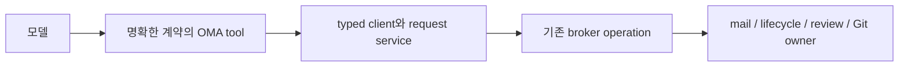

# 모델 도구 표면 전환 명세 — CLI 제거, 같은 계약의 action, 핵심 도구와 선택 도구

상태: **구현 cutover 및 선택 통합 검증 반영 — 실제 Sol 비교는 BLOCKED**. 최초 설계 작성 기준은 `74eadb6fd34c258393a231930fcdf0c85e601af6`이다. 모델용 OMA CLI를 없애고 기능을 typed 도구로 이관했다. 모든 action을 분리하는 이전 안 대신 **입력 계약이 같은 행동만 묶고, 핵심 도구는 항상 제공하며, 나머지는 필요한 것만 선택**한다. 이 상태는 실제 모델의 목표 달성률·비용 개선이나 전체 release qualification의 완료를 뜻하지 않는다.

이 문서는 전환 목표·모델 공개 계약·제거 범위·완료 기준을 소유한다. [PRIORITY-0](PRIORITY-0.md)의 durable fact·현재 권한·관측 구분은 유지한다. 현재 구현 계약은 [implementation-spec](implementation-spec.md), 유지보수 절차는 [MAINTENANCE](MAINTENANCE.md), 실제 실행 결과는 [validation](implementation/validation.md)을 따른다. 구현 cutover 때 관련 계약·결정 기록을 함께 갱신하며, hash로 고정된 [architecture](architecture.md)는 수정하지 않는다.

현재 구현 기록: 기본 role prompt·생성 START·실행 caller·배포 자산을 typed tool·commit→merge-open·exact optional selection으로 전환했다. prompt-only wording 테스트는 삭제하고 행동·권한·request/session 경계 검증을 유지한다. [DR64](design-revisions.md)의 결정과 현재 운영/구현 계약을 함께 갱신한다. 관측 결과와 미실행 범위는 §9.3 및 [validation](implementation/validation.md)을 따른다.

후속 사용자 최종 제거 방침은 [MCS-S13](model-collaboration-surface-spec.md#mcs-s13--최종-코드의-레거시-제거와-저장-사실의-명시적-비호환)/DR72가 소유한다. 아래 DR64 당시의 exact-selection/구형 action 계약은 역사적 뜻을 유지하지만, 최종 코드에 live decoder·selector·등록을 보존하라는 요구가 아니다. 후속 부분 제거와 미완료/미검증은 validation을 따른다. 이 주석은 collaboration-v1의 activation 승인이 아니다.

## 1. 문제와 목표

전환 전 모델은 OMA의 한 업무를 수행하면서 structured tool, `bash` 안의 OMA CLI, brief/body 파일, 다중-action schema를 오갔다. review 도구는 `action`만 schema상 필수로 선언하지만 실행은 행동별 추가 필드를 요구했고 review status만으로는 정확한 작성자 제외와 reviewer 선택을 끝낼 수 없었다. 이 전환은 해당 불일치를 없앤다. 개별 모델 실패의 원인을 추정해서 broker 정책을 완화하지 않는다.

완료된 제품에서 Worker는 **OMA CLI 호출 없이 reviewer 확보 → 요청 확인 → 독립 review/vote → 적용 확인 → 실행 양보**를 끝낼 수 있어야 한다. 기본 OMA 기능을 사용하기 위해 shell 문법이나 별도의 OMA 명령 참조를 기억할 필요가 없어야 한다.

이하 MUST는 필수, MUST NOT은 금지, SHOULD는 정당한 예외가 없는 한 지켜야 할 요구다.

### 1.1 범위

- Society의 Worker와 Principal에 노출되는 OMA 도구, typed client, 모델용 CLI, prompt/START 안내, 해당 배포 자산과 caller를 전환한다.
- 모델용 CLI의 mail·route·agent·submit·review·context·status·logs 기능을 모두 대응시킨다. 편한 기능만 옮기고 나머지를 shell에 남기지 않는다.
- `oma_merge`/`oma_challenge`의 서로 다른 필수 입력을 한 optional-field schema에 섞는 구조를 제거한다. 같은 입력 계약의 action은 유지할 수 있다. GOAL 게시와 일반 mail send는 분리한다.
- 사람용 `oma` 제품 실행·설정·로그인·운영 진입점은 제거 대상이 아니다. 이것을 Worker의 broker 명령 fallback으로 재사용해서는 안 된다.
- 전체 도구 수를 함께 관리한다. Society의 파일 편집은 기존 hashline 계열로 수렴시키고, 그룹 누적 노출을 선택 집합 교체로 바꾸며, Principal에게 실행 불가능한 LSP 도구를 등록하지 않는다.
- Git·빌드·테스트용 `bash`, 일반 파일 작업, 기존 LSP/web/MCP 기능은 유지한다. 외부 패키지 CLI나 Personal 모드를 없애는 작업이 아니다. 새 편집기·검색 엔진·provider codec은 만들지 않는다.

### 1.2 바꾸지 않는 것

- broker의 신원·incarnation·현재 capability·역할·계보·delegation 검사.
- existing operation method, accepted plan, request hash, receipt, candidate publication, expected-old CAS, review 정족수와 Principal 승인 규칙.
- LOW를 무검사 적용으로 바꾸거나, peer 부족 시 정족수를 낮추거나, reviewer를 broker가 자동 생성하는 정책.
- 새 agent 수 제한이나 자동 재시도 정책. 현재 없는 capacity quota를 이 전환으로 도입하지 않는다.
- 읽기 결과를 실행 권한으로 재사용하는 방식. tool 노출과 status는 권한 grant가 아니다.

## 2. 목표 구조와 책임



- Extension은 tool 이름·설명·schema·결과 presentation을 소유한다. broker 정책을 재구현하지 않는다.
- Client는 행동별 typed input, revision/body 준비, request freeze·receipt 관측·stream 전송을 소유한다. CLI를 spawn하거나 출력 문자열을 다시 parse하지 않는다.
- App의 기존 runtime adapter는 Git·파일·context stream 등 물리 효과를 제공한다. CLI 디렉터리 안의 재사용 코드가 필요하면 적절한 기존 runtime owner로 옮기고 모든 caller를 이관한다.
- Broker와 domain은 기존 권한·정족수·작성자 판정의 유일한 owner다. status에 필요한 projection도 같은 사실과 계산을 사용한다.
- 내부 `attest.record`의 `kind` 및 기존 `Client.review` 같은 구현상 dispatch는 유지할 수 있다. 같은 인자를 받는 작은 enum과 임의 operation/JSON을 받는 범용 dispatcher는 다르다.
- Public client input은 행동별 타입으로 표현한다. `Record<string, unknown>`에 optional 필드를 몰아 넣은 새 외부 API로 기존 문제를 옮기지 않는다.

### 2.1 외부 근거와 선택

| 근거 | 이 설계에 적용하는 내용 | 적용하지 않는 주장 |
|---|---|---|
| [OpenAI Function calling](https://developers.openai.com/api/docs/guides/function-calling) | 명확한 이름·설명, invalid state를 줄이는 schema, 초기 도구 수 절제. 초기 20개 미만은 **soft suggestion**이므로 출발점으로만 사용 | 19개면 항상 최적이거나 20개부터 실패한다는 법칙 |
| [OpenAI Tool search](https://developers.openai.com/api/docs/guides/tools-tool-search) | 자주 쓰는 도구는 직접, 드문 도구의 전체 schema는 필요할 때 제공 | 특정 Responses API의 deferred tool·cache 동작이 현재 모든 Pi provider에서 자동 지원된다는 가정 |
| [Anthropic Writing effective tools](https://www.anthropic.com/research/writing-tools-for-agents) | CLI/API endpoint를 기계적으로 하나씩 복제하지 않고 업무·입력 계약을 기준으로 구분. pagination·오류·실제 과제 평가를 설계에 포함 | 다른 모델의 개선 수치를 Sol의 효과로 인용 |
| [Anthropic Effective context engineering](https://www.anthropic.com/research/effective-context-engineering-for-ai-agents), [Advanced tool use](https://www.anthropic.com/research/advanced-tool-use) | 자주 필요한 고신호 정보는 유지하고 나머지는 점진적으로 공개. 탐색 한 단계의 지연도 측정 | schema를 숨기면 비용과 정확도가 무조건 좋아진다는 주장 |

선택은 **안정적인 core + exact-name 선택 도구 `toolset`**이다. 유한하고 작은 카탈로그에 새 의미 검색기나 code-execution gateway를 추가하지 않는다. 설치된 Pi의 기본 tool-search는 비활성 도구를 누적 활성화하고 MCP 탐색도 자신에게 유도한다. 현재 OMA의 단일 MCP proxy와 충돌하므로 그대로 켜지 않는다.

provider-native tool search는 향후 실제 사용 provider·모델과 engine adapter가 검증되면 대체 후보가 될 수 있다. 이번 전환은 기존 공개 `setActiveTools`와 transcript 갱신 경로만 사용한다. 전체 분리·거대 dispatcher·누적 group 세 안의 약점을 동시에 피하되, 실제 Sol에서 최적이라는 결론은 §9의 비교 실행 전에는 내리지 않는다.

## 3. OMA 도구의 공통 계약

### 3.1 입력 schema

이 절의 OMA 입력 규칙은 `toolset`에도 적용한다. 일반 개발·vendor 도구의 고유 입력 계약까지 OMA 형식으로 다시 만들지 않는다.

1. 각 tool의 최상위 입력은 closed object다. 임의 broker method·argv·OMA shell command·raw JSON을 전달하는 dispatcher는 금지한다.
2. action은 **같은 필수 필드·입력 타입·대상**을 받는 작은 행동 집합에서만 허용한다. 각 effect는 description에 구분한다. 필수 인자가 다른 open/status/diff/vote/cancel을 한 schema에 합치지 않는다.
3. 모든 필수 필드는 provider schema의 `required`에 있어야 한다. enum은 평범한 string enum으로 표현한다. 같은 이름의 역할별 schema는 허용하지만 Principal approval처럼 역할에 필요한 필드를 optional로 만들지 않는다.
4. 미지의 필드와 잘못된 원시 타입은 효과 전에 거절한다. 숫자·boolean·null을 문자열 body/name/action으로 보정하지 않는다. execute 직접 호출도 같은 closed 입력을 검증한다.
5. action별 object를 최상위 `anyOf`/`oneOf`로 묶지 않는다. 조건부 인자가 필요하면 §4의 이름 있는 object 또는 별도 tool을 사용한다.
6. identifier·path·text·UTF-8 byte bound는 기존 domain/protocol 검사를 재사용한다. JS character 수 제한만으로 broker byte bound와 같다고 주장하지 않는다.
7. 새 호출의 request name은 현재 domain의 full UUID 문법만 허용한다. extension에만 남아 있는 8-hex 축약 문법을 제거한다. 과거 기록 읽기 정책은 durable owner가 유지한다.
8. 로컬 shape 오류는 transport·파일 생성·Git publication 전에 거절한다. 유효한 입력이라도 권한·base·policy 변화에 따라 broker가 거절할 수 있다.
9. required/optional/default 설명은 tool description과 schema에 둔다. prompt에 두 번째 인자 명세를 복사하지 않는다.

현재 고정 Pi AI 버전의 strict 변환은 object union을 거절하고, Anthropic non-strict 변환은 최상위 `properties`/`required`만 옮기는 경로가 있다. TypeBox에서 유효한 schema라는 사실은 provider가 같은 계약을 받았다는 증거가 아니다. 구현 시에는 실제 설치된 버전의 전송 payload를 다시 검증한다.

Strict 지원 provider에서는 기존 engine의 strict 기능을 사용한다. 추가 property 금지·required 보존·optional의 nullable 변환을 실제 payload에서 확인하고, 지원하지 않는 provider를 strict라고 표시하지 않는다. 최종 provider/model 설정으로 검증하지 않은 schema 지원을 추정하지 않는다.

설치된 Pi validator는 optional null 정규화를 제공하지만 `Value.Convert`도 수행한다. 실제 probe에서 필수 `body: null`이 `"null"`로 변환됐다. OMA 도구와 `toolset`은 `prepareArguments`에서 **non-coercing shape guard**를 수행한 뒤 기존 validator로 넘긴다. guard는 정본 schema에서 파생하며 optional property의 null만 허용하고 required의 타입은 완화하지 않는다. 이 검사용 schema를 provider에 보내지 않는다. optional-null 제거는 Pi가 소유하며, required `expectedRevision: null`의 CAS 의미는 유지한다. 새 provider 변환기나 필드별 임시 보정은 만들지 않는다.

### 3.2 공통 타입과 request

- `Actor`: 기존 agent 이름/address 정규화 규칙. 새 agent 이름은 기존 create 이름 검사를 따른다.
- `Revision`: 로컬 Git에서 commit으로 해석되는 문자열. full OID도 포함한다. 해석은 새 mutation의 freeze 준비 때 한 번만 수행한다.
- `RequestName`: `merge-<full UUID>` 또는 `challenge-<full UUID>`. 공통 review tool은 이름으로 종류를 판별한다. merge만 받는 challenge open은 해당 종류까지 검증한다.
- `Text`: 기존 연산의 문자열·byte 제한. brief·review body·vote body·reason은 공백만 있는 값을 허용하지 않는다. title/subject의 header 제한을 유지한다.
- `ExpectedRevision`: full OID 또는 `null`. `null`은 초기 context가 없을 것으로 기대한다는 뜻이지 무조건 덮어쓰기라는 뜻이 아니다.
- 아래 표에서 mutation으로 표시한 모든 tool은 선택적 `request: string`을 추가로 받는다. 표에서 반복하지 않는다.
- 읽기 tool과 `oma_agent_wait`는 mutation용 `request`를 받지 않는다. receipt 조회 인자는 별도 `key`다.

명시적 `request`와 생략 시의 안정적인 request-key 생성은 기존 request service/shared helper가 소유한다. 응답 유실·재시작·관측 실패 후에는 원래 key와 frozen input을 사용한다. accepted/unknown을 새 key의 재실행으로 바꾸지 않는다. 같은 key의 revision·body·brief·bundle은 현재 파일이나 HEAD로 다시 만들지 않는다.

### 3.3 결과와 오류

- Pi 결과 envelope는 기존 text content와 details를 유지한다. 모델이 읽는 text 자체에 request key, receipt/state, query 결과 또는 오류가 있어야 한다. 모델에 전달되지 않는 details에만 핵심 정보를 넣지 않는다.
- Mutation은 원래 receipt의 `operation`, `state`, `result`/`error` 의미와 실제 request key를 보존한다. accepted operation 성공과 후속 작업 완료를 혼동하지 않는다.
- 오류는 원래 `code`, `message`, `retry`, 허용된 `details`, 알려진 receipt를 보존한다. 로컬 오류를 가짜 broker receipt로 만들지 않는다.
- 복구 안내는 호출할 tool과 `request` 또는 `key`를 지칭한다. `--request`, 셸 명령, `oma …`를 요구하지 않는다. tool result·client exception·cache 오류·oversize 안내까지 대상이다.
- Oversized 답은 기존 spool/preview 또는 해당 query pagination으로 읽을 수 있어야 한다. `truncated`, `omitted`, `next`를 숨기지 않는다.
- `oma_operation_status`는 현재 actor의 원래 key만 조회한다. 큰 receipt의 `operation.read` 조립은 client 내부에서 처리한다. 다른 actor의 receipt나 임의 broker method를 조회하는 우회 tool은 만들지 않는다.

## 4. 전체 tool 목록과 노출

이 절이 전환 후 이름과 입력의 정본이다. W는 Worker, P는 Principal이다. **핵심**은 항상 노출, **선택**은 `toolset`으로 명시적 선택, `—`는 해당 역할에 제공하지 않음을 뜻한다. 역할에 노출된다는 것은 현재 capability가 있거나 연산이 성공한다는 뜻이 아니다.

### 4.1 Agent·society·관측

| Tool | W | P | 종류 | 필수 입력 | 선택 입력 / 의미 |
|---|---|---|---|---|---|
| `oma_agent_create` | 핵심 | — | mutation | `name: Actor`, `from: Revision`, `brief: Text` | inline brief, 기존 `agent.create`·child policy·frozen spec·초기 메일 |
| `oma_agent_control` | 선택 | 핵심 | mutation | `action: start/stop`, `name: Actor` | 각 기존 operation의 self/descendant·Principal release 제한 유지 |
| `oma_agent_continue` | 선택 | — | mutation | `note: Text` | 자신의 후속 delivery |
| `oma_agent_wait` | 핵심 | — | ephemeral | 없음 | 현재 live run을 안전한 경계에서 양보 |
| `oma_society` | — | 핵심 | mutation | `action: open/close` | 기존 올바른 action 계약과 이름 유지 |
| `oma_status` | 핵심 | — | read | 없음 | 선택 `agent: Actor`, `after: Actor`; roster와 자기 생성 조건 |
| `oma_logs` | 선택 | — | read | `agent: Actor`, `sinceSeconds: positive safe integer` | 문자열 duration 문법 불필요 |
| `oma_operation_status` | 선택 | 선택 | read | `key: string` | 자기 `operation.get`, 필요하면 내부 `operation.read` |

`oma_agent_create`는 brief 파일을 요구하지 않는다. `from`은 canonical 저장소에 존재하는 commit이어야 하며 현재 main과 같아야 한다는 새 제약을 추가하지 않는다. 기존 동일 spec의 create 연결/replay와 다른 spec의 이름 충돌을 유지한다.

생성 반환은 `provisioning`, `enabled`, 실제 실행 시작을 구분한다. 모델은 receipt와 named status로 관측한다. GOAL·activation·profile·capability 거절을 prompt 추측으로 대체하지 않는다. 자식 권한 계산은 기존 delegation intersection과 host-granted 예외를 유지한다.

DR66: `maxWorkers` defaults to 6 active Workers and a new configuration starts with 3 Workers. Active means resident plus `desired=enabled`, including idle enabled Workers; Principal, provisioning, stopped and retired rows do not count. Historical registration has no lifetime cap. Fresh create at full active capacity refuses with `LIMIT_EXCEEDED` before acceptance. Publication and stopped-to-enabled start check the same capacity atomically; an already-accepted creation that loses a slot race stays pending/provisioning until reconciliation can activate it. Replay and already-enabled start do not consume another slot. Unknown physical termination still blocks unsafe reuse. Capacity changes require broker restart; fresh create/start on stale policy refuse, and a cap below the enabled registry fails closed without automatically deleting Workers.

Worker의 control은 무관한 peer 제어 권한을 주지 않는다. Principal start는 자신의 force-stop 해제이며 일반 작업 배정 기능이 아니다. Principal에게 create·continue·wait·roster/log 도구를 노출하지 않는다.

`oma_agent_wait`는 blocking receive도 durable mutation도 아니다. 현재 run에 의도를 남기고 실행 중 tool과 accepted 효과를 손상시키지 않는 기존 delivery 경계에서 continuation을 끝낸다. `observe: true`는 engine 내부 관측으로만 남긴다. wait를 정상 delivery 완료 receipt로 승격하지 않는다.

wait의 보류 대상은 broker가 현재 live run에 교부한 정확한 batch의 message IDs와 해당 automatic invocation이 이어받은 이전 보류 IDs뿐이다. 아직 교부하지 않은 메일은 wait 전에 도착했거나 batch 크기 제한으로 남았어도 다음 activation 대상이다. 첫 wait를 반복해도 보류 범위를 넓히지 않으며, 이전 실행의 늦은 batch 준비 응답은 새 run에 연결하지 않는다. explicit start와 broker 복구는 기존 oldest-first 재전달 정책을 유지한다.

`oma_status.after`는 기존 `next`를 이어 읽는다. `agent`와 `after`의 기존 필터 의미를 보존하며, 다음 페이지를 얻기 위해 모델이 이름을 추측하게 하지 않는다.

### 4.2 Mail·구독·context·candidate

| Tool | W | P | 종류 | 필수 입력 | 선택 입력 / 의미 |
|---|---|---|---|---|---|
| `oma_mail_read` | 핵심 | 핵심 | read | `messageId: string` | 기존 id/archive path 및 `/inbox.md` 읽기·audience 제한 |
| `oma_mail_send` | 핵심 | 핵심 | mutation | `to: Actor/address[]`, `subject: string`, `body: string` | `kind`, `replyTo: MessageId`; 일반 `mail.send` |
| `oma_mail_reply` | 선택 | 선택 | mutation | `messageId: MessageId`, `body: string` | `to`, `subject`, `kind`; 생략은 기존 reply 준비 규칙으로 상속 |
| `oma_mail_ack` | 핵심 | — | mutation | `messageId: MessageId` | 자기 delivery만 처리 |
| `oma_topic_subscription` | 선택 | — | mutation | `action: follow/unfollow`, `topic: string` | 각 기존 route operation |
| `oma_goal_publish` | — | 핵심 | mutation | `body: Text`, `subject: string`, `expectedRevision: ExpectedRevision` | `context.publish` + `goalMail`; 다른 context 문서 보존 |
| `oma_context_publish` | 선택 | — | mutation | `directory: string`, `expectedRevision: ExpectedRevision` | 일반 `context.publish`; 현재 capability 필요 |
| `oma_candidate_publish` | 선택 | — | mutation | `candidate: Revision`, `subject: string`, `body: string` | `to: Actor/address[]`, `paths: string[]`; 기본 commons·빈 paths |
| `oma_mail_approval_notice` | 선택 | — | mutation | `subject: string`, `body: string`, `candidate: full OID`, `base: full OID`, `policyRevision: string` | `cc: Actor/address[]`, `replyTo: MessageId`; 기존 특수 메일 |

일반 send/reply의 `kind`는 `message`(기본값), `question`, `result`, `alert`, `critical`, `context`다. `context` 표기는 context 게시나 GOAL 권한을 만들지 않는다. 생성된 review/approval metadata를 모델이 임의 주입할 수 없다. reply가 audience 제한을 우회해서도 안 된다.

`oma_mail_approval_notice`는 기존 CLI의 후보 tuple 첨부 메일 기능을 보존한다. **Notice이며 recorded vote·정족수·유효 review approval 요청을 만들지 않는다.** `approval_required` kind와 principal 수신자를 고정하고 cc를 중복 제거해 추가한다. 기존 candidate publication 검사를 유지하고 자동 submit하지 않는다. HIGH와 capacity fallback의 유효 승인 요청은 broker만 생성한다. 일반 notice id를 review approval로 취급하지 않는다.

`oma_goal_publish`는 inline body로 현재 context 보존·expected revision CAS·goal mail의 원자적 의미를 유지한다. 일반 context는 실제 여러 파일을 게시하므로 directory 입력을 유지하며 기존 no-follow·허용 path·byte bound·`GOAL.md` 요구를 재사용한다. Worker 기본 profile에 `context.publish` 권한을 추가하지 않는다.

`oma_candidate_publish`는 별도 후보 공유용이다. `paths`는 submission 요약 정보이지 candidate tree를 잘라 제출하는 선택자가 아니다. merge open의 선행 필수 호출이 아니다.

### 4.3 Review: open은 분리하고 같은 계약은 공통화

| Tool | W | P | 종류 | 필수 입력 | 선택 입력 |
|---|---|---|---|---|---|
| `oma_merge_open` | 핵심 | — | mutation | `tier: LOW/MEDIUM/HIGH`, `title: Text`, `reason: Text` | `candidate: Revision`, `base: Revision` |
| `oma_challenge_open` | 핵심 | — | mutation | `merge: merge RequestName`, `tier: LOW/HIGH`, `title: Text`, `reason: Text` | `replacement: {candidate: Revision, base: Revision}` |
| `oma_review_list` | 선택 | — | read | `kind: merge/challenge` | `after: RequestName` |
| `oma_review_status` | 핵심 | — | read | `name: RequestName` | `reviewerAfter: Actor` |
| `oma_review_diff` | 핵심 | 핵심 | read | `name: RequestName` | `view: proposal/original`, `path: string`, `cursor: nonnegative safe integer` |
| `oma_review_respond` | 핵심 | 핵심 | mutation | W: `name`, `action: comment/approve/reject`, `body: Text`; P: `name`, `action: approve/reject`, `body: Text`, `approval: MessageId` | 없음 |
| `oma_review_cancel` | 선택 | — | mutation | `name: RequestName`, `reason: Text` | 없음 |

**왜 이렇게 묶는가:** list는 kind가 필수이고 status는 name이 필수다. diff에는 page/view 입력이, cancel에는 필수 reason이 있으므로 각각의 계약을 유지한다. 반면 comment/approve/reject는 항상 같은 name/body를 받아 같은 review에 기록한다. 따라서 respond 안에서 action으로 묶고 effect를 명시한다. `comment`는 토론만 남기고, **`approve`/`reject`만 기존 vote로 기록**한다. 승인에 필요한 body를 optional로 만드는 분기는 없다.

Merge open의 candidate 기본값은 HEAD, base 기본값은 기록된 base다. base 부재·stale 오류를 유지한다. client가 candidate known 여부를 확인하고 필요할 때만 기존 하위 submit 요청을 실행한다. uncommitted 변경이 포함되지 않는 경고를 보존한다.

Challenge는 applied merge만 대상으로 한다. HIGH merge를 LOW로 challenge할 수 없다. `replacement`가 없으면 현재 canonical main 위에 revert를 준비한다. 있으면 object 내부 candidate/base가 둘 다 필수이고 기존 wire pair로 내린다. 새 inverse-patch 검사나 자동 수정 정책은 추가하지 않는다.

공통 diff의 기본 `proposal`은 merge의 frozen base→candidate 또는 challenge의 준비된 revert/replacement다. `original`은 대상 원래 merge의 patch이며, merge request에서는 proposal과 동일하다. 종류별 기존 client 경로를 사용하고 불필요한 diff를 추가 계산하지 않는다. 결과에 실제 source request·view·base·candidate·policyRevision·digest·전체 크기·next를 명시한다. 기존 64 KiB UTF-8 페이지·path 축소·전체 document bound를 보존한다.

LOW merge does not accept advance comments/votes. All request authors are excluded from Worker approve/reject votes. Normal peer requirements are one for MEDIUM merge and `highPeerFloor` for HIGH merge and every challenge. Potential peer capacity is `maxWorkers` minus currently enabled resident authors in the requester/submitter union, not the number of all historical authors. If that capacity is insufficient, the broker requires the independent approvals that fit, followed by Principal approval; zero-peer fallback emits approval mail with opening. Missing/stopped reviewers, provisioning failures and negative votes are not fallback reasons. HIGH always requires Principal approval; LOW merge is unchanged. Being an author of the original merge does not alone exclude an actor from reviewing its challenge.

Principal respond에는 approval이 필수이고 comment가 없다. Principal에게 open/list/status/cancel을 추가하지 않는다. diff 내부 좁은 status 조회와 승인 메일로 받은 요청의 기존 가시성을 유지한다. cancel의 requester·terminal 제한도 기존 broker가 판단한다.

### 4.4 OMA 이외의 전체 기본 카탈로그

| Tool | W | P | 용도 / 결정 |
|---|---|---|---|
| `read` | 핵심 | 핵심 | 기존 containment를 적용하는 hashline 읽기 |
| `write` | 핵심 | — | 새 파일·전체 파일 작성; 기존 안전한 writer |
| `replace` | 핵심 | — | 읽은 anchor 사이의 범위 교체·삭제; 기본 부분 편집 |
| `bash` | 핵심 | — | Git·빌드·테스트 등 일반 개발 명령; OMA CLI 없음 |
| `grep` | 핵심 | 핵심 | 내용 검색 |
| `find` | 핵심 | 핵심 | 파일 이름/패턴 탐색 |
| `ls` | 핵심 | 핵심 | 디렉터리 열람 |
| `insert` | 선택 | — | 기존 anchor 기준 삽입 |
| `replace_within` | 선택 | — | 기존 anchor 범위 안 문자열 치환 |
| `lsp_diagnostics` | 선택 | — | 현재 지원하는 LSP 진단·symbol 관련 조회 |
| `lsp_fix` | 선택 | — | 현재 지원하는 LSP 수정/preview |
| `lsp_status` | 선택 | 선택 | LSP 상태; Principal에게 spawn 불가 도구는 등록하지 않음 |
| `web_search` | 선택 | 선택 | 웹 검색 |
| `source_check` | 선택 | 선택 | vendored web 도구의 source 확인 |
| `fetch_content` | 선택 | 선택 | URL 콘텐츠 가져오기 |
| `get_search_content` | 선택 | 선택 | 검색 결과 콘텐츠 열기 |
| `mcp` | 선택 | 선택 | 기존 단일 MCP proxy; 서버 도구의 검색·호출 계약 유지 |
| `ask_user_question` | — | 핵심 | 사람이 붙어 있는 Principal에서 질문 |

기본 편집기는 새로 만들지 않는다. 현재 hashline read→replace의 anchor/session·stale/identity 검사와 contained writer를 재사용한다. 중복 literal `edit`은 Society 모델 표면에서 제거한다. Linux/macOS 기본 loadout의 미지정 `powershell`도 자동 노출하지 않는다. 검증된 사용자 extension은 별도 admission을 거쳐야 하며 기본 숫자에 몰래 포함하지 않는다.

Scoped `grep` and `find` snapshot only the requested file or subtree plus the ancestor ignore inputs needed to preserve search semantics. An unrelated sibling is not traversed or required to be readable. Workspace-relative result paths, explicit-file ignore behavior, link restrictions, repository-metadata isolation and private-snapshot cleanup remain unchanged.

`insert`/`replace_within`은 삭제하지 않고 선택 도구로 보존한다. LSP/web/MCP 내부 동작·vendor 알고리즘은 이번 변경에서 재작성하지 않는다. 현재 없는 독립 `definition`/`references`/`rename`, 브라우저 클릭·스크린샷, 다른 제품의 `task`/`todo`/`eval`을 지원 도구로 기재하지 않는다.

### 4.5 `toolset`: 선택 집합을 교체하는 하나의 도구

`toolset`은 W/P 모두 **핵심**, ephemeral이다. 입력은 `{"select": ["허용된 선택 도구 이름", "..."]}`다. `select`는 필수 배열이며 중복·미등록·다른 역할·core 이름은 거절한다. 빈 배열은 core만 남긴다. broker mutation용 request는 받지 않는다.

OpenAI strict-schema 호환성을 위해 `select`의 provider schema에는 `uniqueItems`를 넣지 않는다. 중복 선택은 기존 런타임 집합 검사로 거절하며, enum·입력 shape·안전 경계 검증은 유지한다.

- `select`의 enum은 해당 역할과 provenance admission을 통과한 실제 optional registry에서 만든다. description에는 이름과 짧은 용도 목록을 항상 제공한다. 상세 schema만 선택 전까지 생략한다. 이름을 추측하거나 외부 명령 문서를 열어야 발견할 수 있게 하지 않는다.
- 의미는 **추가가 아니라 전체 optional 선택 집합 교체**다. core를 해제할 수 없다. 별도 검색 query, raw args 전달, 다른 도구 실행, 자동 작업 계획을 받지 않는다.
- 선택된 도구는 다음 model request에서 원래 typed tool로 직접 호출한다. `toolset`은 우회 실행 dispatcher가 아니다. `code_intel`·`file_edit`·`web_research` 및 새 management group을 함께 유지하지 않는다.
- 실행은 sequential로 등록한다. shape/이름 검증 후 선택을 예약하고, 현재 tool batch와 결과 저장이 끝난 기존 `turn_end` 경계에서 exact active set을 적용한다. 같은 batch의 이미 제출된 호출을 중간에 비활성화하지 않는다. 같은 turn에서 여러 유효 선택이 있으면 순서상 마지막 전체 선택이 다음 turn의 집합이다.
- 결과에는 요청한 optional 목록, 제거될 목록, 다음 active count, 적용 시점을 명시한다. 다음 요청 전에 actual active set이 정확히 일치하는지 기존 surface owner가 확인한다. 불일치를 성공처럼 보고 계속하지 않는다.
- Pi의 public `setActiveTools`는 unknown 이름을 무시할 수 있으므로 호출 전에 validation한다. provenance 검증 실패·registry 불일치는 기존 fail-closed 경계를 유지한다. 이름만 OMA처럼 보이는 extension을 신뢰하지 않는다.
- OMA-owned 이름 집합과 always-visible core를 분리한다. 기본 admission은 `DISABLED`로 두고 core/optional을 명시한다. 현재처럼 모든 OMA 이름을 `always`에 넣거나 미분류 builtin을 자동 DIRECT로 만들지 않는다.
- 검증된 extension 등록 변화도 같은 owner와 안전 경계에서 처리한다. 임의 tool output·MCP metadata만으로 새 최상위 도구를 자동 활성화하지 않는다. 핵심 또는 선택된 도구를 조용히 누락하지 않는다.
- resume/fork/branch는 기존 Pi tool-definition/session 기록을 통해 같은 branch의 마지막 확정 loadout을 복원한다. 새로운 DB·durable workflow·일반 재시도 시스템을 만들지 않는다. pending 선택과 이미 확정된 snapshot을 구분하며, 다음 provider 입력의 도구와 실제 callable registry가 일치해야 한다.

예시 흐름: `{"select":["web_search","fetch_content"]}`를 호출하고 다음 turn에 웹 도구를 사용한다. 이어 `{"select":["lsp_diagnostics"]}`를 호출하면 웹 도구는 빠지고 LSP 진단만 선택된다. `{"select":[]}`로 core에 돌아간다. 선택은 권한 grant가 아니며 기존 broker·파일·프로세스 검사는 그대로다.

### 4.6 정확한 수와 한계

| 역할 | 핵심 OMA | 핵심 일반 도구 | toolset | 최초 노출 합계 | 선택 가능한 추가 | 전부 선택 시 합계 |
|---|---:|---:|---:|---:|---:|---:|
| Worker | 11 | 7 | 1 | 19 | 21 | 40 |
| Principal | 7 | 5 | 1 | 13 | 8 | 21 |

OMA 계약은 서로 다른 이름 24개다. 전체 W/P 합집합은 `toolset` 포함 43개다. 역할 간 공유 이름은 중복 계산하지 않는다. Personal의 기본 5개 도구는 이번 변경 대상이 아니다. 이 숫자는 기본 Society registry이며 사용자 extension과 MCP의 동적 서버 목록까지 고정된 총수라고 주장하지 않는다.

19/13은 **초기 노출 수이지 상한이 아니다**. 선택한 schema는 더해지고, 선택을 교체하거나 비우면 빠진다. 선택 단계가 latency를 추가하고 카탈로그 이름/짧은 설명은 처음부터 token을 쓴다. 동적 정의 변경으로 provider cache checkpoint가 바뀔 수도 있으므로 토큰·cache·turn 수를 실제로 측정한다. 숫자를 맞추려고 필요한 도구를 잘라내거나 새 quota를 만들지 않는다.

### 4.7 발견성과 결과 크기

- create·status·review diff/respond·challenge open·wait를 사용하기 위해 `toolset`을 먼저 부르게 하지 않는다. 필요한 기존 peer를 찾고 부족하면 생성해 독립 vote를 받는 흐름은 전부 core다.
- capability 부족을 숨기기 위해 core를 매 turn 임의로 없애지 않는다. 역할 surface는 안정적으로 유지하고 거절·관측으로 현재 조건을 설명한다.
- description 첫 문장은 효과와 용도다. 같은 action의 차이, 전제, 반환의 완료 수준, 오류 후 가능한 경로를 짧게 추가한다.
- catalog용 짧은 설명은 실제 tool metadata에서 파생한다. 두 번째 수기 기능 목록을 runtime에 만들지 않는다.
- status/list는 판단에 필요한 사실·명시적 생략·cursor를 우선한다. receipt/error/digest를 숨겨서 token만 줄이거나 임의 요약으로 바꾸지 않는다.
- provider의 tool 수·schema 크기 제한은 실제 역할과 선택 집합으로 확인한다. 한도 초과 시 조용히 도구를 누락하지 않는다.

## 5. 상태와 다음 행동에 필요한 사실

### 5.1 Review detail

기존 `identity`, `requester`, `display`, `required`, `approvers`, `rejectors`, `principal`, `integration`, `main`, `entries`, `missing`, challenge `target`을 유지한다. 다음을 추가한다.

| 필드 | 의미 |
|---|---|
| `observedAtMs` | 이번 detail의 관측 시점. 미래 실행 권한이 아님 |
| `remainingApprovals` | `max(0, required - approvers.length)`; terminal/blocked에서도 승인 숫자만 의미 |
| `acceptingWorkerVotes` | 현재 request state에서 Worker vote를 받을 수 있는지. LOW merge·terminal·integration 존재 시 false; actor별 권한까지 보장하지 않음 |
| `reviewers.items` | 이름순으로 정렬한 resident/작성자 관측 페이지 |
| `reviewers.next` | 다음 `reviewerAfter`로 넘길 마지막 이름, 완료면 null |

각 reviewer row는 `name`, `desired`, `exclusions`, `latestVote`를 갖는다. `latestVote`는 현재 request의 그 actor의 최신 recorded verdict 또는 null이다. `exclusions`는 해당하는 `author`, `not-enabled`, `missing-mail-send`를 모두 담는다. 작성자 이름에 대응하는 agent가 관측되지 않으면 `missing-agent`를 담고 desired를 null로 둔다. 모든 resident와 frozen authors의 합집합을 대상으로 하며 Principal은 peer가 아니다.

`exclusions`가 비어 있다는 것은 **현재 roster·frozen capability 기준의 투표 후보**라는 뜻이다. 실제 호출 때의 lease·incarnation·사회 실행 상태·request 변화에 대한 권한 검사를 생략하지 않는다. 현재 승인 집계는 기존 evaluator대로 유지하며, 새로 표시한 `mail.send` 정보 때문에 과거 accepted vote의 집계 규칙을 바꾸지 않는다.

작성자 집합은 기존 `ReviewState.authors`를 사용한다. 후보 tip만 비교하거나 Git author 문자열로 대신하지 않는다. approve eligibility와 stopped reject 유지 규칙을 status 전용 로직으로 다시 구현하지 않는다. `remainingApprovals == 0`을 applied/ready/Principal 승인 완료로 바꾸지 않는다. `missing`의 기존 host-policy·completion-size·integration 실패 정보를 보존한다.

Frame bound 안에서 reviewer page를 자른다. 최신 entries와 reviewer page의 예산을 명시적으로 나누되 한쪽을 조용히 모두 소실시키지 않는다. 상세 entry 생략은 기존 표시를 유지하고 reviewer 생략은 반드시 cursor로 이어 읽을 수 있어야 한다. 한 row조차 못 싣는 경우 기존 크기 오류로 거절한다. 새 roster quota를 만들지 않는다.

### 5.2 Review list와 wire 확장

기존 `review.status` 읽기 method를 재사용한다. `oma_review_list`는 필수 `kind: merge/challenge`와 선택 `after`를 전달한다. Named detail에는 `name`과 선택 `reviewerAfter`를 전달한다. 이 두 입력 형태는 내부 protocol의 closed 계약으로 검증하며 섞인 selector를 거절한다.

List는 기존 acceptance 순서의 최신 요청부터 반환하고 `after`가 가리키는 해당 kind의 요청 뒤를 이어 읽는다. 응답은 `requests`, `next`, 기존 main 관측을 제공한다. cursor는 해당 kind의 실제 request 이름이어야 한다. kind 필터를 client에서 이미 잘린 mixed list에 적용하지 않는다. 빈 페이지를 전체 없음으로 오해하게 만드는 생략을 금지한다.

Detail의 reviewer 페이지는 이름순 seek이며 호출 사이 roster/권한 변화가 가능하다. 관측 timestamp와 한계를 명시하고 새 durable snapshot 저장소는 만들지 않는다. 정확한 실행 판단은 broker가 다시 한다. Principal의 내부 named status는 현재의 좁은 projection을 유지하고 Worker roster·작성자·미공개 request를 노출하지 않는다.

DR66의 detail은 `normalRequired`, 실제 peer 요구 수 `required`, `maxWorkers`, `capacityFallback`, `principalRequired`를 함께 제공한다. `principal.sent`와 Principal의 좁은 가시성은 open 시 발행한 0-peer 승인도 포함한다. 현재 승인 id·peer 표의 유효성은 매 mutation과 최종 적용에서 다시 판단한다.

### 5.3 자신의 생성 조건

Worker `oma_status` 응답은 기존 roster 외에 caller 자신의 생성 관측을 포함한다. `creation`은 `capability: boolean`, `childProfile: string|null`, `childHasMailSend: boolean|null`, `workerCount: number`, `maxWorkers: number|null`, `observedAtMs`를 가진다. 정책을 관측할 수 없으면 관련 필드를 null로 두고 기존 허용 오류 정보를 함께 반환하며 false로 추정하지 않는다.

`creation.workerCount` is the current enabled-resident count, not all registered identities. An available logical slot is not a promise of immediate execution: physical stop confirmation, current policy and the existing readiness/activation gates still apply.

현재 caller capability와 기존 child resolver의 결과를 재사용한다. 실행이 없는 delegation 계산을 공유할 필요가 있으면 기존 owner 안에서 분리한다. 가짜 agent 이름/from/brief로 실제 create를 실행하거나 두 번째 policy interpreter를 만들지 않는다. 이 정보는 이름 충돌·canonical commit·GOAL·activation·host 오류까지 통과했다는 보증이 아니다. 다른 agent의 전체 capability/profile 비밀을 roster에 공개하지 않는다.

기존 peer 재사용과 새 Worker 생성은 맥락 재사용·독립 작업의 가치·준비 비용을 비교해 모델이 판단한다. 서버는 `nextActions`로 실행 계획을 강제하거나 자동으로 표·reviewer를 만들지 않는다.

## 6. Prompt와 예시

- 기본 system prompt·tool description·parameter help·추가 모델 guidance는 영어로 작성한다. Worker prompt는 자율 실행, 작업 시작/담당 범위 공유, 독립 작업 분할, 대기 중 유용한 작업, 증거 전달, 검증·통합까지의 책임을 소유한다. 이는 경험에 따라 개선하는 기본 습관이지 고정 통신 절차가 아니다.
- Worker는 메일을 팀의 공유 기억으로 사용한다. 작업 시작·범위 변경·인터페이스 결정·재사용할 발견·중요한 실패/막힘·작업 결과는 commons를 통한 전체 Worker 공유가 기본이다. 특정 상대에게만 유용한 세부 질문/답변은 개별 메일로 보낸다. 수신 범위 원칙은 Worker prompt의 communication 절에 모으며, 매 단계 중계·반복 상태 보고·전체 로그·자동 적용 통지의 단순 재전송은 제외한다. 별도 발송 절차나 보고 의무를 추가하지 않는다.
- Tool description/schema가 호출법의 유일한 정본이다. prompt와 START에 CLI 사용법 또는 인자 표를 복제하지 않는다.
- START는 경로·저장소·메일·tool 환경을 안내한다. 모델용 `oma` 명령, `--file` brief, `oma submit` 선행 필수 흐름을 제거한다.
- 정상 merge 흐름은 commit 후 `oma_merge_open`이다. 단독 candidate publication은 별도 공유 목적일 때만 설명한다.
- Principal prompt의 GOAL 게시·society 제어·force-stop/release·review tool 이름도 함께 정합화한다. `oma_society`의 올바른 action 표현은 유지한다.
- `promptSnippet`과 guideline을 다시 구성하는 기존 prompt-boundary hook을 유지한다. custom prompt·workspace context·활성 tool guidance가 합쳐진 **최종 provider 입력**을 검증한다.
- 기존 custom prompt를 자동으로 덮어쓰지 않는다. 전환 시 사용 중인 custom prompt의 obsolete 명령을 진단하고 운영자에게 위치를 알려준다. 사용자가 작성한 본문을 새 규범으로 몰래 재작성하지 않는다.
- 선택 도구가 필요하면 `toolset.select`에서 이름을 선택하고, 작업 전환 시 집합을 교체한다는 원칙만 prompt에 둔다. 긴 카탈로그·schema·CLI 문법을 중복 삽입하지 않는다. 복잡한 입력 예시는 실제 모델 비교 결과가 뒷받침하는 경우에만 늘린다.
- Principal은 설계·계획·중요 판단에 집중하고 Worker는 구현·조사·테스트·동료 검토를 수행한다. Principal이 모든 국소 결정을 재검사하도록 요구하지 않는다. GOAL에는 특정 Worker 배정·고정 Worker 역할·Worker별 작업 목록을 넣지 않는다.
- LOW merge는 사전 peer 승인 없는 정상 fast path다. 적용 통지와 diff의 자동 공유, 결함 발견 후 challenge를 설명하되 추가 사전 review gate를 만들지 않는다. LOW challenge의 peer 승인 요건은 별개다.
- Codex CLI의 [현재 모델별 instructions template](https://github.com/openai/codex/blob/b75d1e89665d256bf2c674b9590776f440c9bae7/codex-rs/models-manager/models.json), [coding prompt](https://github.com/openai/codex/blob/b75d1e89665d256bf2c674b9590776f440c9bae7/codex-rs/core/gpt-5.2-codex_prompt.md), [shell tool specification](https://github.com/openai/codex/blob/b75d1e89665d256bf2c674b9590776f440c9bae7/codex-rs/core/src/tools/handlers/shell_spec.rs)을 참고한다. 역할/원칙/자율 완결/협업/검증/경계의 구성과 operation·result 중심 도구 설명을 채택하되 Codex 고유 API·권한·프로세스 수명은 이식하지 않는다.
- OMA wrapper가 builtin·동봉 vendor 도구의 설명을 소유한다. vendor 실행 바이트와 schema의 검증 제약은 유지한다. `bash`는 기존 Pi factory를 사용하며 실행 시 읽을 수 있는 `shellPath`·`shellCommandPrefix` 설정을 보존한다. Principal에 편집 안내나 비노출 hashline 도구의 사용법을 주입하지 않는다.

예시: `oma_agent_create` 입력. revision은 새 요청을 freeze할 때 해석되며 brief에 실제 요청을 명시한다.

```json
{
  "name": "worker-4",
  "from": "origin/main",
  "brief": "Review merge-00000000-0000-4000-8000-000000000001. Inspect the exact diff and relevant checks. Cast your own approve or reject vote.",
  "request": "recruit-reviewer-worker-4"
}
```

예시: Worker의 `oma_review_respond` 입력. 호출자는 이 요청의 작성자가 아니어야 한다. `action: "comment"`로 바꾸면 승인표가 아니라 토론이다.

```json
{
  "name": "merge-00000000-0000-4000-8000-000000000001",
  "action": "approve",
  "body": "Reviewed the full patch and verified the affected behavior.",
  "request": "vote-independent-review-1"
}
```

예시의 확인 문구는 검사를 대신하지 않는다. 실제 모델 행동 검증에서는 증거 없이 이 문구만 출력하면 성공으로 판정하지 않는다.

## 7. CLI 제거와 기존 코드 이관

### 7.1 대응 누락을 허용하지 않는 전환표

| 기존 모델용 표면 | 전환 후 |
|---|---|
| `oma send`, `oma ack` | mail send/reply/read/ack 및 특수 approval notice 도구 |
| `oma follow`, `oma unfollow` | `oma_topic_subscription`의 동일 입력 action |
| `oma agent create/start/stop/continue/wait` | create/control/continue/wait; wait observe는 engine 내부 |
| `oma submit` | candidate publish; merge open의 내부 publish도 유지 |
| `oma merge …`, `oma challenge …` | 두 open과 공통 review list/status/diff/respond/cancel |
| `oma send --intent goal`, `oma_mail_send intent:goal` | goal publish |
| `oma context publish` | context publish |
| `oma status`, `oma logs` | pagination 가능한 status와 logs |
| `oma society …`, `oma_society` | 기존 `oma_society`의 open/close action |
| `oma_agent_lifecycle` | 역할별 `oma_agent_control` |
| CLI 표현으로 된 retry/receipt 안내 | operation status 및 원래 tool의 same-key 안내 |
| `code_intel`, `file_edit`, `web_research` | `toolset`의 정확한 선택 집합; 누적 group 제거 |
| 중복 `edit`, 자동 노출된 `powershell` | Society 기본 표면에서 제거; 기존 hashline 편집·일반 개발 shell 유지 |
| Principal의 실행 불가 `lsp_diagnostics`/`lsp_fix` | Principal 등록에서 제외; 읽기 권한 완화로 해결하지 않음 |

### 7.2 제거 대상과 보존 대상

- 모델용 `apps/oma/src/cli.ts`, command parser/dispatcher, command별 handler, CLI 전용 exit/usage/transport wrapper를 제거한다. 재사용되는 물리 준비·request-intent 코드는 먼저 owner를 이관하고 caller를 바꾼다.
- `DEPLOYMENT_LAYOUT.cli/modelCommand/modelCommandBuilder`, `modelCommandScript()`, sandbox PATH의 모델용 libexec, `OMA_CLI`와 CLI 전용 환경 필드·launch path 계약·manifest 항목·build/check-package 전제를 제거한다. 공유 node/runtime preload 항목은 실제 소비자가 남아 있으면 유지한다.
- `apps/oma/package.json`의 model-command 생성 metadata와 해당 build 산출물을 제거한다. 설치 tarball과 sandbox 어느 쪽에도 호출 가능한 구 model CLI가 남지 않아야 한다.
- `oma_merge`, `oma_challenge`, `oma_agent_lifecycle` 및 구 group을 register하거나 alias로 연결하지 않는다. `oma_society`는 유지한다. 기존 mail send의 GOAL intent는 거절한다.
- 기존 사람용 제품 진입점과 native runtime·sandbox 권한·broker socket 인증은 보존한다. model CLI 삭제를 raw RPC의 새 보안 경계라고 주장하지 않는다. 같은 actor가 직접 프로토콜을 구성하더라도 기존 broker 검사가 막아야 할 것은 계속 막아야 한다.
- 테스트 fixture·functional harness·Pi launch plan·package isolation·배포 manifest·운영 문서에 남은 구 CLI 의존성을 모두 이관한다. historical transcript·accepted bytes·archive 문서는 과거 사실로 보존하며 검색 결과에서 현재 callable surface와 구분한다.

### 7.3 주요 변경 owner

| Owner / 현재 경로 | 변경 책임 |
|---|---|
| [extension composition](../packages/extension/src/mail-tools.ts), [current action registration](../packages/extension/src/collaboration-tools.ts) | 계약별 등록·raw shape guard·역할별 schema·고정된 effect·결과 rendering. DR64 당시 `review-tools.ts`/`principal-tools.ts` 등록 모듈은 DR72 후속 제거 대상이었으며 원문은 Git history에 보존 |
| [client](../packages/client/src/index.ts), [request service](../packages/client/src/request-service.ts), [shared tool helper](../packages/tool-runtime/src/shared.ts) | typed use case·inline 입력·안정적 key·receipt 조회·비-CLI 복구 안내 |
| [runtime adapter](../apps/oma/src/runtime/client-runtime.ts), [input effects](../apps/oma/src/runtime/input-effects.ts) | 필요한 물리 준비 코드 이관; 셸 wrapper 삭제 |
| [current domain surface](../packages/domain/src/collaboration-surface.ts), [surface runtime](../packages/tool-runtime/src/tool-surface.ts), [prompt](../packages/domain/src/role-prompts.ts), [views](../apps/oma/src/views.ts) | DR72 이후 current role catalog·explicit admission·cumulative group·provenance가 이 위치에 있다. DR64의 `packages/domain/src/tool-surface.ts#planToolSurface`와 exact-set `toolset`은 제거됐고 역사적 뜻을 현재 동작으로 재분류하지 않는다 |
| [review authority](../packages/review/src/authority.ts), [status](../packages/review/src/status.ts), [status projection](../packages/review/src/status-projection.ts) | 기존 authority를 사용한 reviewer 관측·list/detail pagination |
| [public protocol](../packages/protocol/src/methods.ts), [public dispatcher](../packages/broker/src/public-dispatcher.ts), contracts/response codec | 읽기 계약 확장·role visibility·frame bound |
| [child policy](../packages/domain/src/child-policy.ts), lifecycle/config | 생성 관측에 기존 delegation 계산 제공; 정책 변화 없음 |
| [resident paths](../packages/domain/src/resident-paths.ts), [deployment layout](../packages/domain/src/deployment.ts), engine/App/scripts | model CLI 자산·env·launch·manifest·검사 의존성 제거 |
| [extension 등록](../packages/extension/src/index.ts), [hashline adapter](../packages/tool-hashline/src/index.ts), [LSP adapter](../packages/tool-lsp/src/index.ts), engine launch plan | 기존 편집기 수렴·Principal 불가 도구 미등록·미분류 builtin 자동 노출 제거; vendor 동작 재작성 없음 |

새 tool마다 broker workflow를 복제하지 않는다. implementation 중 소유 파일 분할이 필요하면 기존 package 경계와 DAG를 유지하며, 이 표를 새 추상화 계층을 추가하라는 지시로 해석하지 않는다.

## 8. 전환 중 request·session 안전성

1. 실행 중인 engine의 도구 집합을 부분 교체하지 않는다. 기존 수명 규칙으로 안전한 경계에서 engine을 종료하고 한 deployment의 새 registry·prompt·client로 다시 시작한다. 전체 tool 계약을 동시에 cutover한다.
2. DB, accepted operation, request cache, candidate refs, mail, session 기록을 새 이름에 맞춰 지우거나 재작성하지 않는다. 구 tool 이름은 history data로 남을 수 있지만 실행 alias로 남지 않는다.
3. 기존 자동 request key는 tool 이름과 session history에 영향을 받는다. 따라서 구 미확정 호출을 새 이름으로 다시 key 생성해서 보내면 안 된다.
4. 재개 전 미확정 mutation은 원래 frozen key와 receipt로 복구한다. 구 tool-call 기록의 이름/인자는 **원래 key를 찾는 읽기 자료**로만 사용할 수 있다. 기존 frozen request와 연관이 증명되면 새 typed use case로도 같은 wire intent·key를 replay할 수 있다. retired tool 자체를 실행하지 않는다.
5. 원래 key나 연관을 확인할 수 없으면 결과를 unknown으로 보존하고 근거를 설명한다. 작업을 완료했다고 보고하거나 새 key로 같은 효과를 재발행하지 않는다. 확정 가능한 나머지 작업을 막기 위한 가짜 전역 migration state는 추가하지 않는다.
6. 재개된 모델에는 새 활성 도구 계약을 제공하고, history에 있는 구 tool 이름/CLI는 현재 호출 표면이 아님을 알린다. provider transcript의 tool-definition 갱신은 기존 Pi mechanism을 사용한다.
7. 이미 접수된 CLI request의 회수·replay는 동일 method/params/key라는 durable 계약으로 보존한다. 호출했던 실행 파일이 없어졌다고 accepted effect를 취소한 것으로 처리하지 않는다.
8. 새 surface 내에서의 `toolset` 선택 변경은 deployment cutover와 다르다. 같은 계약의 등록 도구 중 노출만 바꾸며 §4.5의 batch 경계를 지킨다. 재시작·branch 전환 시 pending 선택 때문에 확정 loadout이나 원래 request 복구를 잃지 않도록 검증한다.

## 9. 검증 계약

### 9.1 결정적 기능·경계 검증

기존 scenario/fixture를 새 surface로 이관한다. 등록 이름이나 복사한 schema 문자열의 일치만으로 완료 판정하지 않는다. 실패 가능한 consumer-visible 행동과 durable 결과를 확인한다.

| 시나리오 | 수용 결과 |
|---|---|
| 필수 name/body/reason/Principal approval 누락, 알 수 없는 필드·식별자, body의 null/숫자/boolean | raw guard와 execute가 효과 전에 거절; 문자열로 coercion하지 않음 |
| 전 역할 core 및 선택 집합의 provider 직렬화 | 이름·필수 인자·enum·nested replacement 보존; 빈 schema·누락 tool 없음; strict 여부를 실제 기록 |
| optional null과 required CAS null | 기존 Pi normalization을 거쳐 전자는 생략, 후자는 보존; 정상 인자가 오거절되지 않음 |
| 웹 선택 → LSP 선택 → 빈 선택 | 선택 집합 교체·core 유지; 미등록/다른 역할 이름은 효과 없이 거절 |
| toolset과 다른 호출이 같은 batch, 중단·재시작·fork/branch | 현재 batch를 손상시키지 않음; 다음 provider 정의와 callable registry 일치; 확정 snapshot 보존 |
| 늦은 extension 등록·shadow·불가능한 surface | provenance와 역할 검사를 거쳐야 노출; 조용한 누락·권한 상승·미분류 자동 활성화 없음 |
| hashline read → replace 및 stale anchor·파일 identity 변경 | 정상 부분 수정 성공; stale/다른 파일 교체 거절; 기존 containment 유지 |
| Principal 기본/선택 loadout | 허용된 읽기·대화 기능만 제공; spawn 불가 LSP 도구로 유도하지 않음 |
| create 기본 profile | inline brief가 초기 메일이 되고 기존 spec/receipt 및 준비 상태를 관측할 수 있음 |
| create 권한 없음 / childProfile 없음 / child에 mail.send 없음 | 원래 거절 또는 관측 사유가 구분됨; 투표 가능 자식이라고 추정하지 않음 |
| 과거 canonical commit에서 create | 현재 main과 다르다는 이유만으로 거절하지 않음; 저장소에 없는 commit은 거절 |
| 동일 key create replay / 이름 충돌 / lost reply | 기존 물리 생성·초기 메일을 중복 생성하지 않고 원래 receipt 의미 보존 |
| MEDIUM에서 review만 작성 후 vote | 토론은 정족수에 안 들어가고 유효한 peer vote만 들어감 |
| 작성자 또는 기여 commit submitter의 approve/reject | 둘 다 SELF_REVIEW; 토론 권한과 혼동하지 않음 |
| LOW merge 및 잘못 적용된 변경 | 사전 review/vote 불가; applied 확인 뒤 challenge 경로 사용 |
| LOW challenge | 현재 highPeerFloor만큼 peer 필요; 원래 merge 작성자만이라는 이유로 추가 배제하지 않음 |
| HIGH peer 충족 및 Principal 결정 | 현재 approval id로만 결정; 추가 표가 기존 유효 approval을 불필요하게 재발행하지 않음 |
| peer 중지·재투표·reject 유지·stale approval | 기존 evaluator 및 CAS recheck와 projection이 일치 |
| open/vote receipt 성공 후 integration 실패/unknown | 적용 완료로 표시하지 않고 실제 status를 전달 |
| 긴 diff 및 path·UTF-8 pagination | next를 끝까지 읽으면 동일 exact diff/digest; 잘못된 cursor와 document bound 거절 |
| 큰 roster·review 목록·reviewer 페이지 | 모든 페이지 접근 가능, kind 혼합 없음, 부분 목록을 전체로 오인시키지 않음 |
| candidate publish 및 context/GOAL/reply/route/logs | CLI 없이 동일 업무 결과; 원래 권한·audience·context CAS 보존 |
| 특수 approval notice | 메일은 만들어져도 peer quorum/유효 approval이 생성되지 않음 |
| wait | 현재 live run만 양보, tool 결과 저장 이후 경계, 정상 delivery 완료를 위조하지 않음 |
| same-key restart·accepted/unknown·cache failure | 원래 bytes·receipt로 관측/복구; 새 key 자동 재시도 없음 |
| 구 session의 미확정 mutation으로 cutover | 원래 key를 찾거나 unknown 유지; 새 tool 이름 때문에 효과를 중복하지 않음 |
| Principal 및 raw RPC의 권한 음성 경로 | create·일반 start·Worker thread/roster 등 기존 제한을 tool 분리로 우회하지 못함 |
| model CLI가 없는 실제 설치·sandbox | 새 도구로 업무 수행, 개발용 Git/build는 유지, 구 model command 실행 불가 |

기존 wording/snippet/schema 전체 복사 golden은 삭제하고 필요한 consumer-visible 행동만 검증한다. 등록 이름·정확한 설명 문구·단순 forwarding을 고정하는 영구 테스트는 만들지 않는다. provider payload·전체 inventory 검사는 throwaway probe 또는 기존 통합 scenario에서 수행한다. 별도 provider emulator/framework를 새 제품 기능으로 만들지 않는다.

### 9.2 실제 모델 행동 검증

Scripted provider는 plumbing 검증이고 실제 모델 선택의 증거가 아니다. 사용 중인 Sol의 **정확한 provider/model id와 medium 설정**을 실행 시 기록한다. `Sol medium`이라는 별칭이나 현재 default만 기록하지 않는다.

| 모델에게 주는 상황 | 관측할 행동 |
|---|---|
| MEDIUM, 충분한 기존 적격 peer | 기존 peer에 메일 요청; 불필요한 create 없음 |
| 적격 peer 부족, 생성과 필요한 delegation 허용 | create tool 선택, 준비 상태 확인, 정확한 request와 독립 검토 brief 전달 |
| 생성 capability 또는 delegable child 부족 | 확인된 사유로 막힘 설명; 존재하지 않는 tool/CLI나 성공을 지어내지 않음 |
| enabled peer가 작성자 또는 mail.send 없음 | 해당 peer에 유효 vote를 기대하지 않고 실제 가능한 대안 판단 |
| LOW merge 적용 후 결함 | applied 상태에 대해 challenge open; LOW merge에 사전 vote 시도하지 않음 |
| review 작성 후 승인 수 부족 | 토론과 vote를 구분하고 자격 있는 peer의 recorded vote를 확보 |
| HIGH가 principal-pending | 추가 reviewer/중복 승인 메일을 만들지 않고 기존 승인 경로를 기다림 |
| stale request, superseded approval | 새 base/request 또는 현재 approval을 사용; 오래된 승인으로 강행하지 않음 |
| 긴 diff·큰 roster | next를 실제로 이어 읽고 부분 정보로 전체 검토를 주장하지 않음 |
| host 생성/실행 실패 또는 결과 불명 | 실제 오류/receipt에 맞춰 대응; 없는 capacity quota나 미실행 성공을 지어내지 않음 |
| 할 일 완료 또는 새 메일을 받아야 함 | 의미에 맞는 종료/wait; polling용 반복 호출로 대체하지 않음 |
| 파일 탐색·부분 수정·검사 | 기존 read/replace/bash로 실제 변경을 검증; 중복 편집기를 찾거나 새 전체 파일을 불필요하게 복사하지 않음 |
| topic/reply/logs 등 선택 도구 필요 | 카탈로그에서 올바른 이름을 선택하고 typed 호출; CLI로 돌아가지 않음 |
| 웹 조사 후 코드 진단으로 작업 전환 | 필요한 web/LSP 도구만 선택·교체; schema를 무작정 누적하거나 core를 잃지 않음 |

같은 초기 데이터·권한·GOAL·모델 설정으로 (A) 현행, (B) 계약만 고치고 모든 도구를 직접 제공하는 비교 fixture, (C) 이 명세의 core/선택 구조를 비교한다. B는 실험 fixture이지 제품에 남길 두 번째 모드가 아니다. 각 시나리오의 독립 세 run은 최소 탐색 증거이며 통계적 우월성 증명이 아니다. 변동이 크면 반복을 늘리고 실행하지 않은 held-out 과제로 확인한다. 모델에게 정답 도구 이름·인자를 task에 넣지 않는다. 실제 diff·검사 증거·recorded vote를 함께 확인한다.

각 run은 최종 prompt, provider에 전달된 tools/schema, 선택한 model/effort, capability/delegation 관측, tool call/result, 관련 receipt·review state·메일·최종 효과를 남긴다. 새 production telemetry 저장소는 만들지 않고 기존 session/scenario 증거를 사용한다.

수용은 모든 run의 권한·중복효과·허위완료 위반 0건, 성공 가능한 과제의 목표 도달, 불가능한 과제의 정확한 거절 설명, OMA CLI 호출 0건으로 판단한다. 첫 호출 인자 오류·불필요한 생성·반복 polling·selector 오선택·목표까지 호출/turn 수·latency·입력/tool-schema token·cache 재사용을 함께 보고한다. 개선은 성공률과 비용을 함께 판단하며 초기 도구 수만으로 판정하지 않는다. 실제 model/provider 실행 환경이 없으면 NOT_RUN/BLOCKED이고 등록 검사로 대체 통과시키지 않는다.

### 9.3 이번 cutover에서 확인한 범위

- 실제 Pi 등록에서 Worker core19/전체40, Principal core13/전체21을 확인했다. 구 모델 CLI·tool alias·group과 Worker의 plain edit/powershell, Principal의 불가 LSP 도구는 제거했다.
- 실제 Pi session의 deterministic assistant stream으로 core→선택→교체→resume→reset, 같은 batch의 이전 도구 실행, 제거된 도구 거절, hashline replace/replace_within/insert를 확인했다. 실제 provider 추론이나 모델의 자발적 도구 선택 증거는 아니다.
- 실제 등록 schema 전체를 설치된 OpenAI Responses·Anthropic serializer에 전달하고 네트워크 전송 직전에 payload를 관측했다. OMA 및 toolset은 Responses strict 변환을 통과하고 필수 필드·enum·nested replacement가 보존됐다. 일부 vendor 도구는 non-strict이며 Anthropic non-strict의 최상위 object closure는 local raw guard가 집행한다. 실제 provider 수용·생성 품질은 미검증이다.
- required null/primitive 거절과 optional-null normalization, required CAS null 보존은 제품의 공통 registration guard에 연결했다. 기존 request freeze/recovery·review·권한 회귀와 실제 설치/sandbox 결과는 validation에 실행별로 기록한다.
- 실제 Sol medium A/B/C 비교는 **BLOCKED/NOT_RUN**이다. 확인한 OMA engine auth에는 provider credential이 없고, 배포 profile은 `pi/current`라 정확한 Sol provider/model/medium 설정을 식별하지 못했다. 환경이나 인증을 추정해 다른 모델로 대체하지 않았다.

## 10. 구현 순서와 완료 기준

1. §4의 공통 입력/역할 계약, core/optional inventory와 raw guard를 확정하고 실제 사용 provider의 payload 보존을 확인한다.
2. 기존 client/request service/runtime 준비 코드를 재사용해 모든 CLI 기능의 tool 경로를 완성한다. inline 입력·same-key recovery·비-CLI 오류 안내를 연결한다.
3. 기존 authority 기반 reviewer/생성 관측과 pagination을 연결한다. mutation의 권한·정족수는 바꾸지 않는다.
4. 기존 surface owner에서 toolset·정확한 집합 교체·session 복원을 구현한다. 편집기 수렴·Principal 불가 도구 제거를 함께 반영한다.
5. registry·prompt·START·모든 caller를 한 deployment로 전환하고 model CLI·구 dispatcher/group·배포 자산을 제거한다. feature flag 뒤의 영구 이중 경로를 남기지 않는다.
6. 기존 계약·결정·운영 문서·verification inventory를 갱신한다. 고정 architecture와 accepted history는 보존한다.
7. 결정적 경계 검증, 실제 설치/sandbox smoke, 실제 Sol의 계약-only 대 core/선택 비교를 수행하고 입력·결과·한계를 기록한다.

완료 조건:

- §4의 모든 지원 역할/행동이 tool만으로 실제 동작하며, 빠진 CLI 기능이 없다.
- 모델에게 이질적 필수 인자를 숨긴 action dispatcher, OMA shell fallback, 생성용 brief 파일 준비가 요구되지 않는다. 같은 계약의 작은 action은 허용된다.
- 실행 결과와 다음 행동 판단에 필요한 request·receipt·reviewer·pagination 정보가 모델이 읽는 결과에 있다.
- 권한·정족수·candidate/base·CAS·unknown·same-key recovery 의미가 보존된다.
- 설치물·launch·manifest·prompt·현재 문서·테스트 caller에 실행 가능한 구 모델용 CLI나 tool alias가 남지 않는다.
- 전체 기능을 카탈로그에 보존하고, core는 항상 보이며, 선택은 누적이 아니라 교체된다. 역할·provenance·schema와 실제 호출 가능 도구가 일치한다.
- §9의 실제 수행 결과가 완료 주장을 뒷받침한다. static/schema 통과, mock 성공, 미구현 인터페이스 존재만으로 완료라 하지 않는다.

## DR67 result and review actions

The existing review action surface includes own-vote withdrawal, legacy adoption
and explicit failed-attempt retry. Host invalidation/recovery does not become an
ordinary Worker/Principal authority. Status reports preparation, execution,
application and notice delivery separately. `read` accepts actor-scoped
`oma-result:` references with bounded byte/line pages; automatic applied diffs
are available through the existing review diff action. Full result retention
does not change source-write permission. The versioned owner contract is
[architecture improvements](implementation/architecture-improvements.md).
